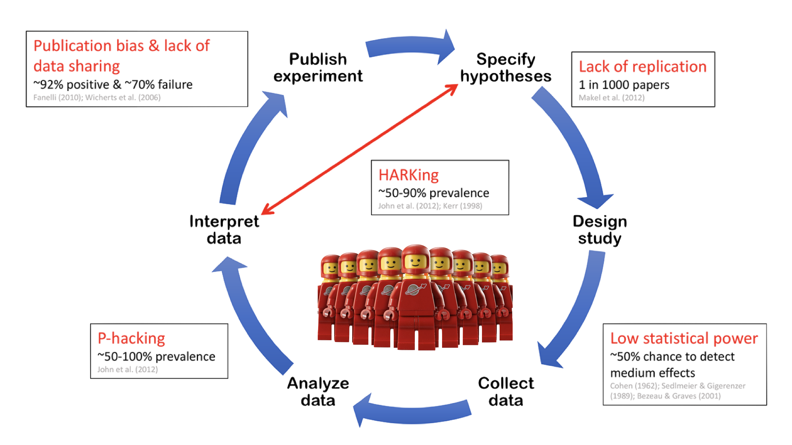

## The Replication Crisis

## ~~Replication Crisis~~ Credibility Revolution!

{fig-align="center" width="320"}

## Open Science

::::: columns
::: {.column width="50%"}
 

-   Being open and transparent across all stages of the research process

    -   Key components:

        -   Dissemnation

        -   Stance

        -   ***Workflow***

            -   Is your entire project pipeline reproducible?
:::

::: {.column width="50%"}
 

{fig-align="center" width="432"}
:::
:::::

## What is Reproduciblity?

| Analysis / Data    | Same Data        | Different Data    |
|--------------------|------------------|-------------------|
| Same Analysis      | **Reproducible** | **Replicable**    |
| Different Analysis | **Robust**       | **Generalisable** |

## Reproducibility Spectrum

{fig-align="center"}

## How are we doing?

::::: columns
::: {.column width="32%"}
-   SCORE reproduciibiliy project

    -   600 papers across 62 journals from several different fields examined between 2009-2018
:::

::: {.column width="68%"}
{.bigfig fig-align="center"}
:::
:::::

## How are we doing?

{fig-align="center"}

## A True Story

-   A `brms` parameterization pitfall in ex-Gaussian RT modeling
-   Package update → silently different defaults
-   Same script, different numbers, no error thrown

::: fragment
**The scary part: nothing crashed.**
:::

------------------------------------------------------------------------

## Why Psych Pipelines Are Fragile

-   Long chains: raw eye-tracking/EEG → preprocessing → modeling → figures
-   Dependency rot: R, Stan, brms, OS libraries all drift independently
-   Ad hoc scripts with no captured environment
-   "It worked on my machine" (six months ago)

------------------------------------------------------------------------

## Reproducibility ≠ One Thing

It's a stack, with a failure point at every layer:

1.  Environment
2.  Workflow / analysis
3.  Statistical modeling
4.  Continuous verification
5.  Materials & data hosting

# Psychology not so good 😟

## Not Just Data: Enviorment Fragility
 
▶ **Software version** — e.g., syntax (\|\>), defaults (stringsAsFactors), and even the RNG change across versions. 

▶ **packages** — e.g., functions get renamed, deprecated, defaults. 

▶ **Document tools** — e.g., Pandoc, LaTeX, Quarto, Juypter 

▶ **System-level dependencies** — e.g., compilers, libpng, BLAS/LAPACK. 

▶ Issue: combining incomplete tools (i.e., stabilize parts of it), which may require diverse expertise (e.g., {renv}, {groundhog}, {rang}, {rig}, and Docker). 

## Layer 1: Environment

-   Containers vs. **Nix**
-   Nix / `{rix}` gives declarative, exact, cross-platform environments
-   Real example: macOS (Apple Silicon) + Determinate Nix
    -   Quarto/pandoc version mismatches
    -   `rstudioWrapper` segfaults
    -   Binary cache trust config

::: notes
Never hand-edit generated .nix files — all config flows through rix().
:::

------------------------------------------------------------------------

## Layer 2: Workflow — Quarto

-   Literate programming: code + prose + output, one document
-   Parameterized reports (rerun for new datasets/conditions)
-   One source of truth from raw data to manuscript

------------------------------------------------------------------------

## Layer 3: Statistical Modeling

-   `cmdstanR` with pinned versions
-   Explicit seeds
-   **Document your parameterization** — don't trust defaults
-   Revisit the ex-Gaussian pitfall: what changed, what it cost

------------------------------------------------------------------------

## Layer 4: Continuous Verification

-   GitHub Actions: does the pipeline rerun *from scratch*?
-   Not "it works on my laptop" — it works on a clean machine, every push
-   A green badge is a reproducibility claim you can point to

------------------------------------------------------------------------

## Layer 5: Materials & Data Hosting

-   Case study: OSF Projects being phased out
-   Lesson: don't bet your archive on one platform forever
-   Emerging split model:
    -   **GitHub** → code, materials
    -   **ResearchBox.org** → curated, citable data packages
-   Registered Reports as a structural incentive, not just preregistration

------------------------------------------------------------------------

## Live Demo

-   Minimal `rix()`-generated environment
-   Quarto doc rendering a Bayesian model
-   GitHub Actions badge confirming a clean rerun

------------------------------------------------------------------------

## What a Lab Can Actually Do

**Not ready for Nix?** Start smaller:

-   `renv` for R dependency snapshots
-   Docker for a shared environment
-   A basic GitHub Actions check that the analysis still runs

Reproducibility is a *ladder*, not a cliff.

------------------------------------------------------------------------

## Culture, Not Just Tools

-   Train RAs on environment capture from day one
-   Make "can a stranger rerun this?" a lab norm
-   Incentives matter more than any single tool

------------------------------------------------------------------------

## Takeaways

1.  Computational reproducibility is a stack — find your weakest layer
2.  Small, boring habits (pinning, CI, version control) beat heroic one-off fixes
3.  Plan for platform churn (OSF → elsewhere) before it forces your hand

------------------------------------------------------------------------

## Questions?

Thanks!