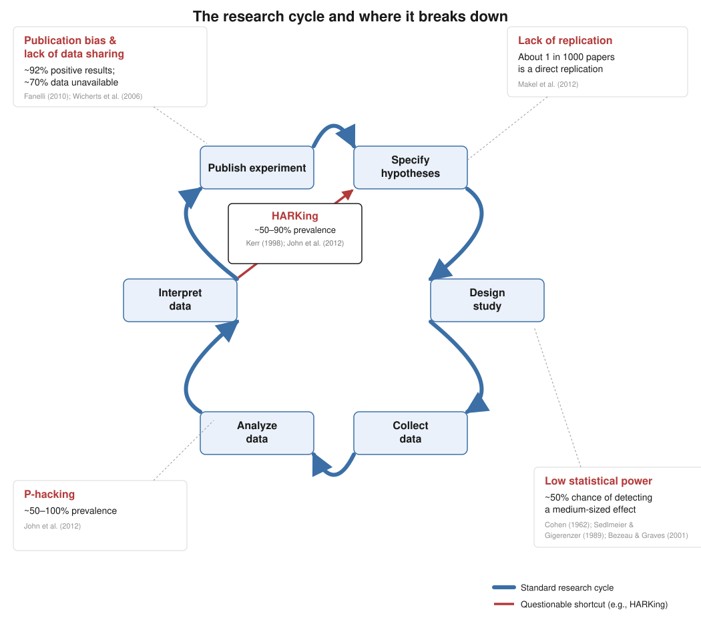
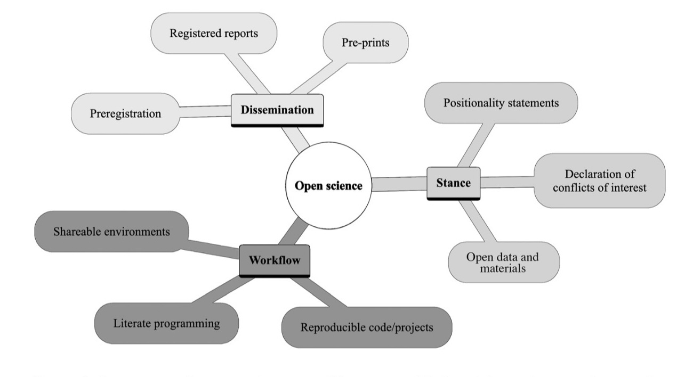
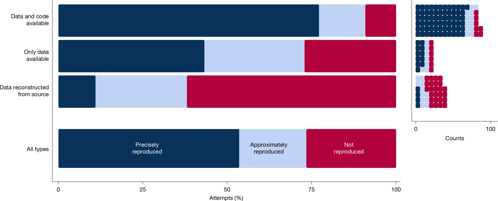
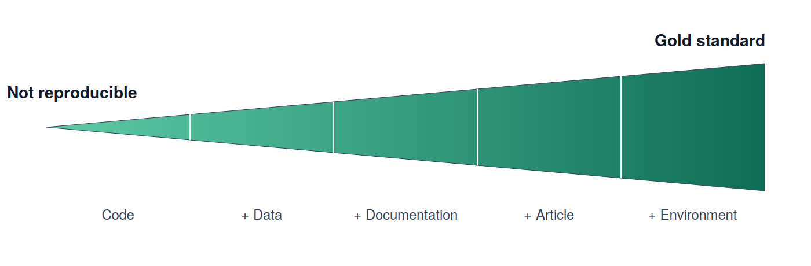
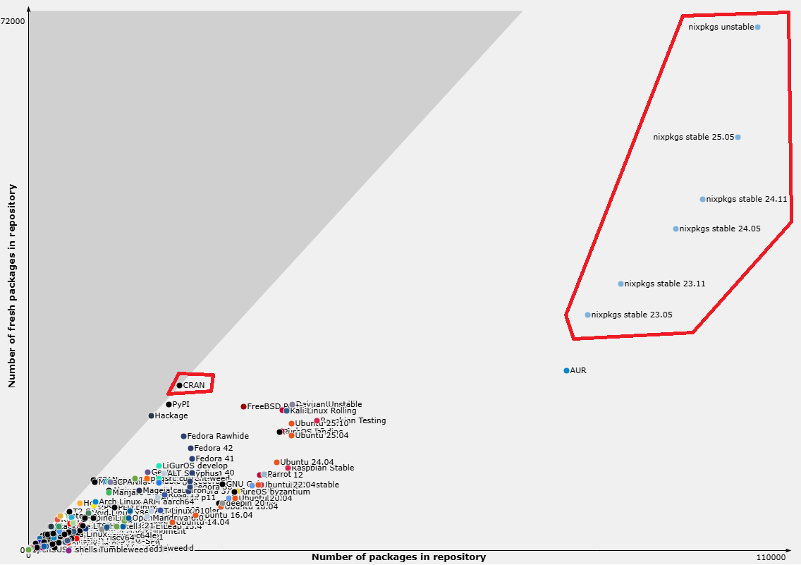

## The Replication Crisis



## ~~Replication Crisis~~ Credibility Revolution! {#sec-cred}

{.hex fig-align="center" width="320"}

## Open Science

::::: columns
::: {.column width="50%"}
<br>

-   Being open and transparent across all stages of the research process

    -   Key components:

        -   Dissemnation

        -   Stance

        -   ***Workflow***

            -   Is your entire project pipeline reproducible?
:::

::: {.column width="50%"}
<br>

{fig-align="center" width="432"}
:::
:::::

## What is Reproduciblity?

| Analysis / Data    | Same Data        | Different Data    |
|--------------------|------------------|-------------------|
| Same Analysis      | **Reproducible** | **Replicable**    |
| Different Analysis | **Robust**       | **Generalisable** |

▎ "Someone else, on another computer, years later, can rerun my code on my data and get my results."

## How are we doing? {#sec-howdoing}

::::: columns
::: {.column width="32%"}
-   SCORE reproduciibiliy project

    -   600 papers across 62 journals from several different fields examined between 2009-2018
:::

::: {.column width="68%"}
{.bigfig fig-align="center"}
:::
:::::

## How are we doing?

{fig-align="center"}

# Psychology not so good 😟

## Why Psych Pipelines Are Fragile

-   Long chains: raw eye-tracking/EEG → preprocessing → modeling → figures
-   Dependency rot: R, Stan, brms, OS libraries all drift independently
-   Ad hoc scripts with no captured environment
-   "It worked on my machine" (six months ago)

## Reproducibility Spectrum {#sec-spectrum}

{fig-align="center"}

## Which "reproducible"? {#sec-repro-blocks}

![Source: [ADD SOURCE]](images/repro-blocks.png){.hex fig-align="center"}

::: notes
Each quote covers only one box. Openness = layer 5, Pipeline = layer 2, the grid = layer 1 (environment).
Point back here later: Docker's saved image covers "across space" but a rebuild breaks "across time";
the Malka et al. evidence slide reports exactly these rows (rebuildable, bitwise, functional).
:::

## Enviorment Fragility

Setting bitwise reproducibility aside, even error-free R code sits on top of 
four layers, each of which may drift over space and time:

1. **R version**
2. **R packages**
3. **Document tools**: e.g., Pandoc, LaTeX, Quarto
4. **System libraries and compilers**: e.g., gcc, libpng, BLAS/LAPACK

## 1. R version {#sec-env-r}

- **Syntax**: the native pipe `|>` exists only since R 4.1.0. 
- **Defaults**: R 4.0.0 stopped turning strings into factors. Same code, different object:

```r
df <- data.frame(group = c("a", "b"))
class(df$group); as.numeric(df$group)
#> R 3.6.3:  "factor"      1  2       (stringsAsFactors = TRUE)
#> R 4.0.0+: "character"  NA NA       (stringsAsFactors = FALSE)
```

- **Random numbers**: R 3.6.0 changed how `sample()` draws. Same seed, different draws:

```r
set.seed(123); sample(1:10, 3)
#> R 3.5.3:   3  8  4        (sample.kind = "Rounding")
#> R 3.6.0+:  3 10  2        (sample.kind = "Rejection")
```

## 2. R packages {#sec-env-pkgs}

- **Renamed or deprecated**: `dplyr::cur_data()`, but now `dplyr::pick()` (warning about the future).
- **Internal functions** (discouraged, but used nonetheless):

## 3. Document tools {#sec-env-docs}

- Pandoc and LaTeX, called by Quarto (also outside R) or by `{rmarkdown}`. Each has its own version.
- From this talk's demo: HTML fine, PDF failed until one more LaTeX package was declared:

```
LaTeX Error: File `lualatex-math.sty' not found.
```

## 4. System libraries and compilers {#sec-env-sys}

- Many R packages are compiled code (C, C++, Fortran) and use libraries from the OS (e.g., libpng, BLAS/LAPACK).
  - Today: CRAN hands you a binary. However, years later: only the source. Your machine compiles it, with today's compiler and today's libraries.
- Same script, different BLAS (illustration in next slides).

## 4. System libraries and compilers (continued) {#sec-env-sys2 .code-walk}

- Based on an illustration by Danielle Navarro; eigenvector sign flip in the system's BLAS/LAPACK (`MASS::mvrnorm()` is not invariant, `mvtnorm::rmvnorm()` fine).

```
== MASS (native R) ==
  macOS:    0.28780065222640439   0.59425558497432929  -0.25961849316812602  -2.3918999759288693
  Ubuntu:  -0.43918332712576574   0.25608933342594919   0.85420518537273971  -2.2883238259260961
  Windows: -0.43918332712576580   0.25608933342594914   0.85420518537273971  -2.2883238259260965
  => DIVERGE
```

## Python, too: language version {#sec-py-version .smaller}

- **Syntax**: `match` statements exist only since Python 3.10, the walrus `:=` since 3.8.
- **Random numbers**: sampling from a set works in 3.10, but the draws depend on set order, which changes *every run* (string hashing). In 3.11+ it errors:

```python
import random; random.seed(1); random.sample({"a", "b", "c"}, 2)
#> Python 3.10:  ['a', 'b']   (or ['c', 'a'], ... depends on the run)
#> Python 3.11+: TypeError: Population must be a sequence.  For dicts or sets, use sorted(d).
```

- **Hashing**: same code, same machine, different order each run (unless `PYTHONHASHSEED` is set):

```python
print(list({"apple", "banana", "cherry"}))
#> run 1: ['cherry', 'apple', 'banana']
#> run 2: ['apple', 'cherry', 'banana']
```

## Python, too: packages {#sec-py-pkgs .smaller}

- **Changed defaults, loud**: pandas 2.0 stopped silently dropping text columns:

```python
df = pd.DataFrame({"group": ["a", "a", "b"], "subject": ["s1", "s2", "s3"], "rt": [500, 520, 610]})
df.groupby("group").mean()
#> pandas 1.5: mean rt per group    (subject column quietly dropped)
#> pandas 2.0+: TypeError: agg function failed [how->mean,dtype->object]
```

- **Changed defaults, silent**: numpy 2.0 changed type promotion. No error, different number:

```python
x = np.float32(0.1) + 0.2
#> numpy 1.26: 0.30000000149011613   (float64)
#> numpy 2.0+: 0.3                   (float32)
```

- **Removed**: `np.float` was removed in numpy 1.24, `DataFrame.append()` in pandas 2.0.
- **Models**: scikit-learn 0.22 changed `LogisticRegression`'s default solver (`liblinear` → `lbfgs`): same call, different coefficients.
- **System libraries**: numpy links OpenBLAS, MKL, or Apple Accelerate depending on how it was installed: the same BLAS story as R.

## Live Demo {#sec-demo-video}

```{=html}
<video src="media/rix-demo.mp4#t=0.5" controls preload="metadata" style="display:block; width:100%; max-height:72vh; margin:0 auto; border:1px solid #ddd; border-radius:6px;"></video>
```

::: notes
Backup recording: a "stranger's laptop" (empty home folder, old Quarto 1.3). Three failures: Typst needs Quarto 1.4+, palmerpenguins missing, CmdStan missing.
:::

## Managing the environment {#sec-env-tools}

- Issue: combining incomplete tools (i.e., stabilize parts of it), which may require diverse expertise (e.g., `{renv}`, `{groundhog}`, `{rang}`, `{rig}`, and Docker).

- More complicated with other programming languages (e.g., Julia and Python).

## `Renv` {#sec-renv}

::::: columns
::: {.column width="72%"}
-   Most popular package for reproducibility, and very easy to use:

    -   `renv::init()` snapshots the packages used (and their versions) into `renv.lock`

    -   `renv::restore()` reinstalls them

-   **But** it records, and does not restore, the version of R

-   **But** installing old packages can fail (missing OS dependencies)
:::

::: {.column width="28%"}
{.hex fig-align="center" width="220"}
:::
:::::

## Docker: what a container does {#sec-docker}

::::: columns
::: {.column width="86%"}
**Dockerfile** (recipe) $\rightarrow$ **image** (the environment, frozen) $\rightarrow$ **container** (the image, running)
:::

::: {.column width="14%"}
{.hex fig-align="center" width="90"}
:::
:::::

{fig-align="center"}

## Docker: rebuilding ≠ reproducing {#sec-docker-issues .code-walk}

```dockerfile
FROM rocker/r-ver:latest                    # which R? whatever "latest" means today
RUN apt-get update && apt-get install -y libxml2-dev   # today's Ubuntu libraries
RUN Rscript -e 'install.packages("brms")'   # today's CRAN
```

-   **The recipe drifts**: every line fetches what's current *on build day*. Only the saved image is frozen; Nix pins the recipe itself.
-   **You must archive the image**: often several GB, and tags on Docker Hub can move or vanish.
-   **Same image, different CPU**: containers run on the host's processor, and OpenBLAS picks code per CPU. The last digits can still differ.
-   **Practical costs**: Linux know-how; Intel-only images are emulated on Apple Silicon; many university clusters don't allow Docker; one company as a single point of failure.

::: notes
Lower-effort alternatives people ask about: Code Ocean (https://codeocean.com/, paid) and Binder (free, can be set up within a manuscript).
:::

## Nix/{Rix} {#sec-nix-intro}

-   **Nix** is a package manager: it installs and manages *packages*, and a package is any piece of software, not just R packages
-   Built for reproducible builds: R, R packages *and* system dependencies, all declared in one text file (a *Nix expression*)
-   Every input is pinned by hash: the same expression gives the same environment, on any machine
-   The "+ Environment" step of the gold standard

## Nix, the package manager: size {#sec-nix-size}

{fig-align="center"}

## Nix: the empirical evidence {#sec-nix-evidence}

Malka, Zacchiroli, & Zimmermann (2025) rebuilt **709,816 packages** from `nixpkgs` snapshots taken every four months, 2017–2023:

- **Rebuildable**: 99.7% to 99.9% still build from their description.
- **Bitwise reproducible**: 69% in 2017, 91% in 2023, rising.
- **Functionally reproducible**: not measured, but follows for every package that rebuilds. From my understanding, every input is pinned by hash, so a rebuild can fail but cannot succeed with different versions. This is not the same with Docker.

::: aside
Malka, Zacchiroli, & Zimmermann (2025)
:::

## Nix: a Nix expression (`default.nix`) {#sec-rix-nix .code-walk}

```{.nix code-line-numbers="2-3"}
let
  pkgs = import (fetchTarball
    "https://github.com/rstats-on-nix/nixpkgs/archive/2026-08-24.tar.gz") {};
  rpkgs = builtins.attrValues {
    inherit (pkgs.rPackages) brms knitr palmerpenguins rmarkdown;
  };
  cmdstanr = pkgs.rPackages.buildRPackage {
    name = "cmdstanr";
    src = pkgs.fetchgit {
      url    = "https://github.com/stan-dev/cmdstanr";
      rev    = "da99e2ba954658bdad63bffb738c4444c33a4e0e";
      sha256 = "sha256-wXfOxBexnuL83fvCM+6qv6d7UhTLGq+Xhvja3lRfQpI=";
    };
  };
  system_packages = builtins.attrValues {
    inherit (pkgs) cmdstan pandoc quarto R;
  };
  shell = pkgs.mkShell {
    buildInputs = [ cmdstanr rpkgs system_packages ];
    shellHook   = "export CMDSTAN=...";
  };
in { inherit pkgs shell; }
```

**The snapshot**: every package definition comes from nixpkgs as it was on 2026-08-24.

## Nix: a Nix expression (`default.nix`) {.code-walk}

```{.nix code-line-numbers="4-6"}
let
  pkgs = import (fetchTarball
    "https://github.com/rstats-on-nix/nixpkgs/archive/2026-08-24.tar.gz") {};
  rpkgs = builtins.attrValues {
    inherit (pkgs.rPackages) brms knitr palmerpenguins rmarkdown;
  };
  cmdstanr = pkgs.rPackages.buildRPackage {
    name = "cmdstanr";
    src = pkgs.fetchgit {
      url    = "https://github.com/stan-dev/cmdstanr";
      rev    = "da99e2ba954658bdad63bffb738c4444c33a4e0e";
      sha256 = "sha256-wXfOxBexnuL83fvCM+6qv6d7UhTLGq+Xhvja3lRfQpI=";
    };
  };
  system_packages = builtins.attrValues {
    inherit (pkgs) cmdstan pandoc quarto R;
  };
  shell = pkgs.mkShell {
    buildInputs = [ cmdstanr rpkgs system_packages ];
    shellHook   = "export CMDSTAN=...";
  };
in { inherit pkgs shell; }
```

**R packages** from that snapshot: exact versions, plus all of their dependencies.

## Nix: a Nix expression (`default.nix`) {#sec-nix-cmdstanr .code-walk}

```{.nix code-line-numbers="7-14"}
let
  pkgs = import (fetchTarball
    "https://github.com/rstats-on-nix/nixpkgs/archive/2026-08-24.tar.gz") {};
  rpkgs = builtins.attrValues {
    inherit (pkgs.rPackages) brms knitr palmerpenguins rmarkdown;
  };
  cmdstanr = pkgs.rPackages.buildRPackage {
    name = "cmdstanr";
    src = pkgs.fetchgit {
      url    = "https://github.com/stan-dev/cmdstanr";
      rev    = "da99e2ba954658bdad63bffb738c4444c33a4e0e";
      sha256 = "sha256-wXfOxBexnuL83fvCM+6qv6d7UhTLGq+Xhvja3lRfQpI=";
    };
  };
  system_packages = builtins.attrValues {
    inherit (pkgs) cmdstan pandoc quarto R;
  };
  shell = pkgs.mkShell {
    buildInputs = [ cmdstanr rpkgs system_packages ];
    shellHook   = "export CMDSTAN=...";
  };
in { inherit pkgs shell; }
```

**cmdstanr from GitHub**: exact commit *and* content hash. If GitHub changes, the build fails rather than silently differing. By hand, you compute that hash yourself.

## Nix: a Nix expression (`default.nix`) {.code-walk}

```{.nix code-line-numbers="15-17"}
let
  pkgs = import (fetchTarball
    "https://github.com/rstats-on-nix/nixpkgs/archive/2026-08-24.tar.gz") {};
  rpkgs = builtins.attrValues {
    inherit (pkgs.rPackages) brms knitr palmerpenguins rmarkdown;
  };
  cmdstanr = pkgs.rPackages.buildRPackage {
    name = "cmdstanr";
    src = pkgs.fetchgit {
      url    = "https://github.com/stan-dev/cmdstanr";
      rev    = "da99e2ba954658bdad63bffb738c4444c33a4e0e";
      sha256 = "sha256-wXfOxBexnuL83fvCM+6qv6d7UhTLGq+Xhvja3lRfQpI=";
    };
  };
  system_packages = builtins.attrValues {
    inherit (pkgs) cmdstan pandoc quarto R;
  };
  shell = pkgs.mkShell {
    buildInputs = [ cmdstanr rpkgs system_packages ];
    shellHook   = "export CMDSTAN=...";
  };
in { inherit pkgs shell; }
```

**System software**: R itself, Quarto, pandoc and CmdStan, from the same snapshot.

## Nix: a Nix expression (`default.nix`) {#sec-nix-shell .code-walk}

```{.nix code-line-numbers="18-21"}
let
  pkgs = import (fetchTarball
    "https://github.com/rstats-on-nix/nixpkgs/archive/2026-08-24.tar.gz") {};
  rpkgs = builtins.attrValues {
    inherit (pkgs.rPackages) brms knitr palmerpenguins rmarkdown;
  };
  cmdstanr = pkgs.rPackages.buildRPackage {
    name = "cmdstanr";
    src = pkgs.fetchgit {
      url    = "https://github.com/stan-dev/cmdstanr";
      rev    = "da99e2ba954658bdad63bffb738c4444c33a4e0e";
      sha256 = "sha256-wXfOxBexnuL83fvCM+6qv6d7UhTLGq+Xhvja3lRfQpI=";
    };
  };
  system_packages = builtins.attrValues {
    inherit (pkgs) cmdstan pandoc quarto R;
  };
  shell = pkgs.mkShell {
    buildInputs = [ cmdstanr rpkgs system_packages ];
    shellHook   = "export CMDSTAN=...";
  };
in { inherit pkgs shell; }
```

**The shell**: everything above, bundled into what `nix-shell` opens. By hand, this means learning Nix. `{rix}` writes it for you, from R.

## Nix/`Rix` {#sec-rix-intro .code-walk}

::::: columns
::: {.column width="78%"}
-   `{rix}` ([website](https://docs.ropensci.org/rix/)) makes writing Nix expressions easy: one R function, `rix()`
:::

::: {.column width="22%"}
{.hex fig-align="center" width="150"}
:::
:::::

```r
install.packages("rix", repos = "https://ropensci.r-universe.dev")
```

## Nix/`Rix`: the `rix()` call {#sec-rix-call .code-walk}

```{.r code-line-numbers="4"}
library(rix)

rix(
  date   = "2026-08-24",
  r_pkgs = c("brms", "palmerpenguins", "knitr", "rmarkdown"),
  git_pkgs = list(
    package_name = "cmdstanr",
    repo_url     = "https://github.com/stan-dev/cmdstanr",
    commit       = "da99e2ba954658bdad63bffb738c4444c33a4e0e"
  ),
  system_pkgs = c("quarto", "cmdstan"),
  shell_hook  = paste(
    "export CMDSTAN=$(dirname $(dirname $(command -v stan)))/opt/cmdstan",
    "export PRECOMPILED_HEADERS=false",
    sep = "\n"
  ),
  ide          = "none",
  project_path = ".",
  overwrite    = TRUE
)
```

**`date`**: becomes the snapshot line in `default.nix`, pinning *everything* to one snapshot of nixpkgs. R and every package come in the versions they had on that day, on any machine, forever.

::: notes
Never hand-edit the generated default.nix: all configuration flows through rix().
:::

## Nix/`Rix`: the `rix()` call {.code-walk}

```{.r code-line-numbers="5"}
library(rix)

rix(
  date   = "2026-08-24",
  r_pkgs = c("brms", "palmerpenguins", "knitr", "rmarkdown"),
  git_pkgs = list(
    package_name = "cmdstanr",
    repo_url     = "https://github.com/stan-dev/cmdstanr",
    commit       = "da99e2ba954658bdad63bffb738c4444c33a4e0e"
  ),
  system_pkgs = c("quarto", "cmdstan"),
  shell_hook  = paste(
    "export CMDSTAN=$(dirname $(dirname $(command -v stan)))/opt/cmdstan",
    "export PRECOMPILED_HEADERS=false",
    sep = "\n"
  ),
  ide          = "none",
  project_path = ".",
  overwrite    = TRUE
)
```

**`r_pkgs`**: CRAN packages, at their versions on that date. `knitr` and `rmarkdown` are here because Quarto needs them to run R code.

## Nix/`Rix`: the `rix()` call {.code-walk}

```{.r code-line-numbers="6-10"}
library(rix)

rix(
  date   = "2026-08-24",
  r_pkgs = c("brms", "palmerpenguins", "knitr", "rmarkdown"),
  git_pkgs = list(
    package_name = "cmdstanr",
    repo_url     = "https://github.com/stan-dev/cmdstanr",
    commit       = "da99e2ba954658bdad63bffb738c4444c33a4e0e"
  ),
  system_pkgs = c("quarto", "cmdstan"),
  shell_hook  = paste(
    "export CMDSTAN=$(dirname $(dirname $(command -v stan)))/opt/cmdstan",
    "export PRECOMPILED_HEADERS=false",
    sep = "\n"
  ),
  ide          = "none",
  project_path = ".",
  overwrite    = TRUE
)
```

**`git_pkgs`**: packages that aren't on CRAN. cmdstanr is pinned to an exact commit (the v0.9.0 release), not \"whatever is on GitHub today\".

## Nix/`Rix`: the `rix()` call {.code-walk}

```{.r code-line-numbers="11"}
library(rix)

rix(
  date   = "2026-08-24",
  r_pkgs = c("brms", "palmerpenguins", "knitr", "rmarkdown"),
  git_pkgs = list(
    package_name = "cmdstanr",
    repo_url     = "https://github.com/stan-dev/cmdstanr",
    commit       = "da99e2ba954658bdad63bffb738c4444c33a4e0e"
  ),
  system_pkgs = c("quarto", "cmdstan"),
  shell_hook  = paste(
    "export CMDSTAN=$(dirname $(dirname $(command -v stan)))/opt/cmdstan",
    "export PRECOMPILED_HEADERS=false",
    sep = "\n"
  ),
  ide          = "none",
  project_path = ".",
  overwrite    = TRUE
)
```

**`system_pkgs`**: software outside R. Quarto and CmdStan are the two things that broke in the demo; now they're part of the environment.

## Nix/`Rix`: the `rix()` call {.code-walk}

```{.r code-line-numbers="12-16"}
library(rix)

rix(
  date   = "2026-08-24",
  r_pkgs = c("brms", "palmerpenguins", "knitr", "rmarkdown"),
  git_pkgs = list(
    package_name = "cmdstanr",
    repo_url     = "https://github.com/stan-dev/cmdstanr",
    commit       = "da99e2ba954658bdad63bffb738c4444c33a4e0e"
  ),
  system_pkgs = c("quarto", "cmdstan"),
  shell_hook  = paste(
    "export CMDSTAN=$(dirname $(dirname $(command -v stan)))/opt/cmdstan",
    "export PRECOMPILED_HEADERS=false",
    sep = "\n"
  ),
  ide          = "none",
  project_path = ".",
  overwrite    = TRUE
)
```

**`shell_hook`**: commands that run each time you enter the environment. Here: tell cmdstanr where CmdStan lives.

## Nix/`Rix`: the `rix()` call {.code-walk}

```{.r code-line-numbers="17-19"}
library(rix)

rix(
  date   = "2026-08-24",
  r_pkgs = c("brms", "palmerpenguins", "knitr", "rmarkdown"),
  git_pkgs = list(
    package_name = "cmdstanr",
    repo_url     = "https://github.com/stan-dev/cmdstanr",
    commit       = "da99e2ba954658bdad63bffb738c4444c33a4e0e"
  ),
  system_pkgs = c("quarto", "cmdstan"),
  shell_hook  = paste(
    "export CMDSTAN=$(dirname $(dirname $(command -v stan)))/opt/cmdstan",
    "export PRECOMPILED_HEADERS=false",
    sep = "\n"
  ),
  ide          = "none",
  project_path = ".",
  overwrite    = TRUE
)
```

**`ide`, `project_path`, `overwrite`**: no IDE (`\"rstudio\"`, `\"positron\"`, `\"code\"` also work); write `default.nix` into this folder.

## Nix/`Rix`: Python too {#sec-rix-python .code-walk}

```{.r code-line-numbers="4-7"}
rix(
  date    = "2026-08-24",
  r_pkgs  = c("brms", "reticulate"),
  py_conf = list(
    py_version = "3.12",
    py_pkgs    = c("pandas", "numpy")
  ),
  ide          = "none",
  project_path = ".",
  overwrite    = TRUE
)
```

```{.bash}
$ nix-shell --pure --run 'python --version'
Python 3.12.14                  # pandas 3.0.4, numpy 2.5.1: same 2026-08-24 snapshot
```

**`py_conf`**: one `default.nix` pins R, Python *and* both sets of packages. R reaches that exact Python through `reticulate`, never a system one.

::: notes
Tested on macOS (Apple Silicon): builds and runs with --pure; reticulate calls the pinned numpy.
:::

## Nix/`Rix`: using it {#sec-rix-use}

```{.bash code-line-numbers="|1|2|3"}
Rscript gen-env.R    # rix() writes default.nix
nix-build            # build the environment (slow only the first time)
nix-shell --pure --run "quarto render nix_rix_example.qmd"
```

- Once, beforehand: install Nix ([nixos.org/download](https://nixos.org/download/), or the Determinate Systems installer)
- `--pure`: nothing from your own machine leaks in: not your R, not your packages, not `~/.cmdstan`
- Plain `nix-shell` drops you into the environment to work interactively

::: notes
Live demo here: same repo that failed earlier, now rendering inside the environment.
Real-world snags on macOS (Apple Silicon) + Determinate Nix: Quarto/pandoc version mismatches, rstudioWrapper segfaults, binary cache trust config.
:::

# Continuous Integration

## CI: what it is {#sec-ci}

-   Every time you push to GitHub, **GitHub Actions** starts a fresh computer and reruns your pipeline from scratch
-   Result: ✅ it ran, or ❌ it broke, and an email telling you which step failed
-   Free for public repositories (a monthly allowance for private ones)
-   "Works on my laptop" becomes **"works on a clean machine, every push"**

## CI: the workflow (`render.yml`) {#sec-ci-workflow .code-walk}

```{.yaml code-line-numbers="2-5"}
name: render-report
on:
  push:
  schedule:
    - cron: "0 6 * * 1"
jobs:
  render:
    runs-on: ubuntu-latest
    steps:
      - uses: actions/checkout@v7
      - uses: cachix/install-nix-action@v31
      - uses: cachix/cachix-action@v17
        with:
          name: rstats-on-nix
      - run: nix-build
      - run: nix-shell --pure --run "quarto render nix_rix_example.qmd"
      - uses: actions/upload-artifact@v7
        with:
          name: report
          path: nix_rix_example.html
```

**When**: on every push, *and* every Monday morning, even if nobody touched the code. That catches things disappearing upstream.

## CI: the workflow (`render.yml`) {.code-walk}

```{.yaml code-line-numbers="8"}
name: render-report
on:
  push:
  schedule:
    - cron: "0 6 * * 1"
jobs:
  render:
    runs-on: ubuntu-latest
    steps:
      - uses: actions/checkout@v7
      - uses: cachix/install-nix-action@v31
      - uses: cachix/cachix-action@v17
        with:
          name: rstats-on-nix
      - run: nix-build
      - run: nix-shell --pure --run "quarto render nix_rix_example.qmd"
      - uses: actions/upload-artifact@v7
        with:
          name: report
          path: nix_rix_example.html
```

**Where**: a brand-new Ubuntu machine, every run. Not your laptop, not your `~/.cmdstan`.

## CI: the workflow (`render.yml`) {.code-walk}

```{.yaml code-line-numbers="10-14"}
name: render-report
on:
  push:
  schedule:
    - cron: "0 6 * * 1"
jobs:
  render:
    runs-on: ubuntu-latest
    steps:
      - uses: actions/checkout@v7
      - uses: cachix/install-nix-action@v31
      - uses: cachix/cachix-action@v17
        with:
          name: rstats-on-nix
      - run: nix-build
      - run: nix-shell --pure --run "quarto render nix_rix_example.qmd"
      - uses: actions/upload-artifact@v7
        with:
          name: report
          path: nix_rix_example.html
```

**Setup**: get the code, install Nix, and pull prebuilt packages from the `rstats-on-nix` cache: minutes, not hours of compiling.

## CI: the workflow (`render.yml`) {.code-walk}

```{.yaml code-line-numbers="15-16"}
name: render-report
on:
  push:
  schedule:
    - cron: "0 6 * * 1"
jobs:
  render:
    runs-on: ubuntu-latest
    steps:
      - uses: actions/checkout@v7
      - uses: cachix/install-nix-action@v31
      - uses: cachix/cachix-action@v17
        with:
          name: rstats-on-nix
      - run: nix-build
      - run: nix-shell --pure --run "quarto render nix_rix_example.qmd"
      - uses: actions/upload-artifact@v7
        with:
          name: report
          path: nix_rix_example.html
```

**Run**: the same two commands you run on your laptop. No `install.packages()` steps: `default.nix` *is* the environment.

## CI: the workflow (`render.yml`) {.code-walk}

```{.yaml code-line-numbers="17-20"}
name: render-report
on:
  push:
  schedule:
    - cron: "0 6 * * 1"
jobs:
  render:
    runs-on: ubuntu-latest
    steps:
      - uses: actions/checkout@v7
      - uses: cachix/install-nix-action@v31
      - uses: cachix/cachix-action@v17
        with:
          name: rstats-on-nix
      - run: nix-build
      - run: nix-shell --pure --run "quarto render nix_rix_example.qmd"
      - uses: actions/upload-artifact@v7
        with:
          name: report
          path: nix_rix_example.html
```

**Keep the output**: the rendered report is saved and downloadable from every run.

## CI: why Nix + CI {#sec-ci-why}

-   **Without Nix**, the workflow needs its own setup steps: install R, packages, CmdStan, Quarto... a *second* environment definition that can drift from yours
-   **With Nix**, CI builds the *same* `default.nix` you use locally: one definition, used everywhere
-   A pinned environment + a weekly run = an early warning if anything upstream vanishes (a GitHub commit, a download URL)

## CI: the payoff {#sec-ci-payoff .code-walk}

-   A green badge in your README: **"this analysis reran from scratch on a clean machine"**

```markdown

```

-   A claim reviewers (and future you) can check with one click
-   ❌ tells you *before* a reviewer does

## Beyond the environment {#sec-beyond}

-   **Workflow (Quarto)**: code, prose and output in one document, one source of truth from raw data to manuscript
-   **Statistical modeling**: pinned `cmdstanr`, explicit seeds, documented parameterization
-   **Materials & data hosting**: OSF Projects are being phased out; don't bet your archive on one platform
    -   GitHub for code, ResearchBox.org for citable data

::: notes
Modeling example to mention: the ex-Gaussian parameterization pitfall (what changed, what it cost).
Also: parameterized Quarto reports for new datasets; Registered Reports as a structural incentive, not just preregistration.
:::

## What a Lab Can Actually Do

**Not ready for Nix?** Start smaller:

-   `renv` for R dependency snapshots
-   Docker for a shared environment
-   A basic GitHub Actions check that the analysis still runs

Reproducibility is a *ladder*, not a cliff.

## Culture, Not Just Tools

-   Train RAs on environment capture from day one
-   Make "can a stranger rerun this?" a lab norm
-   Incentives matter more than any single tool

## Takeaways {#sec-takeaways}

1.  "Reproducible" means many things: say which one you claim, and find your weakest layer
2.  Declare the whole environment once (`{rix}`), and let CI rerun it from scratch
3.  Small, boring habits (pinning, CI, version control) beat heroic one-off fixes
4.  Plan for platform churn (OSF → elsewhere) before it forces your hand

## Questions?

Thanks!
