## Disclaimer {#sec-disclaimer}

::: {.larger}
I will mostly be using {.inline-logo} examples.
:::


## The Replication Crisis[^munafo] {#sec-replication-crisis}

```{dot}
//| label: replication-crisis-cycle
//| echo: false
//| fig-align: center
//| fig-width: 9.5
//| fig-height: 3.7
digraph replication {
  layout=neato
  splines=true
  outputorder=edgesfirst
  bgcolor="transparent"
  pad=0.2
  node [shape=box style="rounded,filled" fillcolor="#EAF1FA" color="#3B6FA6" penwidth=1.5
        fontname="Helvetica-Bold" fontsize=20 fontcolor="#1A1A1A" margin="0.3,0.12"]
  edge [color="#3B6FA6" penwidth=4 arrowsize=0.9]

  publish   [pos="-1.15,1.9!" label="Publish\nexperiment"]
  specify   [pos="1.15,1.9!" label="Specify\nhypotheses"]
  design    [pos="2.3,0!" label="Design\nstudy"]
  collect   [pos="1.15,-1.9!" label="Collect\ndata"]
  analyze   [pos="-1.15,-1.9!" label="Analyze\ndata"]
  interpret [pos="-2.3,0!" label="Interpret\ndata"]

  publish -> specify -> design -> collect -> analyze -> interpret -> publish

  // Problem callouts: class "fragment fN" = appears on click N
  node [shape=box style="rounded,filled" fillcolor="white" color="#D9D9D9" fontname="Helvetica" fontsize=17 margin="0.28,0.14"]
  edge [color="#9A9A9A" penwidth=1.5 style=dashed arrowhead=none]

  power [pos="5.6,-1.6!" class="fragment f1" label=<<font face="Helvetica-Bold" point-size="22" color="#B23A3A">Low statistical power</font><br align="left"/>~50% chance of detecting<br align="left"/>a medium-sized effect<br align="left"/><font point-size="13" color="#767676">Cohen (1962); Sedlmeier &amp; Gigerenzer (1989)</font><br align="left"/>>]
  design -> power [class="fragment f1"]

  phack [pos="-5.3,-1.9!" class="fragment f2" label=<<font face="Helvetica-Bold" point-size="22" color="#B23A3A">P-hacking</font><br align="left"/>~50–100% prevalence<br align="left"/><font point-size="13" color="#767676">John et al. (2012)</font><br align="left"/>>]
  analyze -> phack [class="fragment f2"]

  interpret -> specify [class="fragment f3" color="#B23A3A" penwidth=3.5 style=solid arrowhead=normal
    label=<<font face="Helvetica-Bold" point-size="22" color="#B23A3A">HARKing</font><br/>~50–90% prevalence<br/><font point-size="13" color="#767676">Kerr (1998); John et al. (2012)</font>> fontname="Helvetica" fontsize=17]

  bias [pos="-5.1,2.3!" class="fragment f4" label=<<font face="Helvetica-Bold" point-size="22" color="#B23A3A">Publication bias &amp;<br align="left"/>lack of data sharing</font><br align="left"/>~92% positive results;<br align="left"/>~70% data unavailable<br align="left"/><font point-size="13" color="#767676">Fanelli (2010); Wicherts et al. (2006)</font><br align="left"/>>]
  publish -> bias [class="fragment f4"]

  replic [pos="5.3,2.3!" margin="0.45,0.14" class="fragment f0" label=<<font face="Helvetica-Bold" point-size="22" color="#B23A3A">Lack of replication</font><br align="left"/>About 1 in 1000 papers<br align="left"/>is a close replication<br align="left"/><font point-size="13" color="#767676">Makel et al. (2012)</font><br align="left"/>>]
  specify -> replic [class="fragment f0"]
}
```

```{=html}
<style>
#sec-replication-crisis svg { width: 100%; height: auto; max-height: 560px; }
</style>
<script>
// Graphviz tags each problem's box and its connector as "fragment fN";
// give both the same index so they appear together on click N
document.querySelectorAll("#sec-replication-crisis svg .fragment").forEach(function (el) {
  var m = el.getAttribute("class").match(/\bf(\d+)\b/);
  if (m) el.setAttribute("data-fragment-index", m[1]);
});
</script>
```

[^munafo]: Munafò, M. R., Nosek, B. A., Bishop, D. V. M., et al. (2017). A manifesto for reproducible science. *Nature Human Behaviour*, *1*, 0021. <https://doi.org/10.1038/s41562-016-0021>

## ~~Replication Crisis~~ Credibility Revolution! {#sec-cred}

{.hex fig-align="center" width="320"}

## Open Science {#sec-open-science}

::::: columns
::: {.column width="58%"}
- **Open science:** being open and transparent at every stage of research[^casillas]
- Three parts:
  - Dissemination
  - Stance
  - ***Workflow***: *Could someone else rerun your whole pipeline and get your results?*
:::

::: {.column width="42%"}
<br>

::: {.fragment}
```{r}
#| label: open-science-map
#| echo: false
#| message: false
#| warning: false
#| fig-width: 6.4
#| fig-height: 5.2
#| fig-align: center
#| out-width: 100%
#| dpi: 300
#| dev: ragg_png
# Open science mind map, adapted from Casillas et al. (2025)
library(ggplot2)

hubs <- data.frame(
  branch = c("Dissemination", "Stance", "Workflow"),
  x = c(-1.3, 1.7, -0.5),
  y = c(1.35, 0, -1.4)
)
leaves <- data.frame(
  branch = rep(hubs$branch, each = 3),
  label = c(
    "Preregistration",
    "Registered\nreports",
    "Preprints",
    "Positionality\nstatements",
    "Conflict of\ninterest\ndeclarations",
    "Open data\nand materials",
    "Shareable\nenvironments",
    "Literate\nprogramming",
    "Reproducible\ncode/projects"
  ),
  x = c(-2.85, -1.75, 0.5, 2.4, 3.4, 2.4, -2.75, -2.1, 1.05),
  y = c(2.05, 2.75, 2.6, 1.6, 0, -1.6, -0.5, -2.7, -2.7)
)
leaves$hx <- hubs$x[match(leaves$branch, hubs$branch)]
leaves$hy <- hubs$y[match(leaves$branch, hubs$branch)]
hubs$focus <- hubs$branch == "Workflow"
leaves$focus <- leaves$branch == "Workflow"

maroon <- "#98002E"
grey <- "#B5B5B5"
ink <- "#1A1A1A"

ggplot() +
  # center -> hubs, hubs -> leaves
  geom_segment(
    data = hubs,
    aes(0, 0, xend = x, yend = y, color = focus, linewidth = focus),
    lineend = "round"
  ) +
  geom_segment(
    data = leaves,
    aes(hx, hy, xend = x, yend = y, color = focus, linewidth = focus),
    lineend = "round"
  ) +
  geom_label(
    data = leaves,
    aes(x, y, label = label, fill = focus, color = focus),
    family = "Source Sans Pro",
    size = 6.4,
    lineheight = 0.88,
    label.r = unit(6, "pt"),
    label.padding = unit(5, "pt"),
    linewidth = 0.4,
    text.colour = ink
  ) +
  geom_label(
    data = hubs,
    aes(x, y, label = branch, fill = I(ifelse(focus, maroon, "#6B6B6B"))),
    text.colour = "white",
    family = "Source Sans Pro",
    fontface = "bold",
    size = 7.2,
    label.r = unit(3, "pt"),
    label.padding = unit(6, "pt"),
    linewidth = 0
  ) +
  annotate(
    "point",
    0,
    0,
    size = 38,
    shape = 21,
    fill = "white",
    color = maroon,
    stroke = 1.6
  ) +
  annotate(
    "text",
    0,
    0,
    label = "Open\nscience",
    family = "Merriweather",
    fontface = "bold",
    size = 6.2,
    color = maroon,
    lineheight = 0.9
  ) +
  scale_color_manual(
    values = c(`FALSE` = grey, `TRUE` = maroon),
    guide = "none"
  ) +
  scale_fill_manual(
    values = c(`FALSE` = "white", `TRUE` = "#F6E6EA"),
    guide = "none"
  ) +
  scale_linewidth_manual(
    values = c(`FALSE` = 1, `TRUE` = 2.2),
    guide = "none"
  ) +
  coord_fixed(clip = "off", xlim = c(-4, 4.3), ylim = c(-3.05, 3.05)) +
  theme_void()
```
:::
:::
:::::

```{=html}
<script>
// Show the figure together with "Dissemination" instead of before the bullets
(function () {
  var slide = document.getElementById("sec-open-science");
  var items = slide.querySelectorAll("li.fragment");
  items.forEach(function (li, i) { li.setAttribute("data-fragment-index", i); });
  slide.querySelector(".column + .column .fragment").setAttribute("data-fragment-index", 2);
})();
</script>
```

[^casillas]: Figure adapted from Casillas, J. V., Constantin-Dureci, G., Andreu Rascón, I., et al. (2025). Opening open science to all: Demystifying reproducibility and transparency practices in linguistic research. *Linguistics*, *63*(6), 1547–1575. <https://doi.org/10.1515/ling-2023-0249>

## What is Reproducibility?

| Analysis / Data    | Same Data        | Different Data    |
|--------------------|------------------|-------------------|
| Same Analysis      | **Reproducible** | **Replicable**    |
| Different Analysis | **Robust**       | **Generalisable** |

::: notes
Hand-off: Top-left cell is today's topic. Same data, same code: that should be the easy one, right? Let me show you. -> demo
:::

## Demo {#sec-demo}

  - <https://github.com/jgeller112/Rix-Nix_Test>


## Demo: everything is shared {#sec-demo-path .smaller}

```
study1/
├── analysis.R
└── data/
    └── data_final.csv
```

```r
# analysis.R
dat <- read.csv("data/data_final.csv")

cohens_d <- function(x) {
  m <- tapply(x$recall, x$condition, mean)
  s <- sqrt(mean(tapply(x$recall, x$condition, var)))
  unname((m["retrieval"] - m["control"]) / s)
}

set.seed(2018)
boot <- replicate(2000, cohens_d(dat[sample(nrow(dat), replace = TRUE), ]))

round(cohens_d(dat), 2)
round(quantile(boot, c(.025, .975)), 2)
```

::: {.fragment}
Paper (2019): *d* = 0.45, 95% bootstrap confidence interval (CI) [0.01, 0.91], which excludes zero
:::

## Demo: same code, different year {#sec-demo-path2 .smaller}

|                  | 2019: author (R 3.5.3) | 2026: me (R 4.6.1)        |
|------------------|------------------------|---------------------------|
| *d*              | 0.45                   | 0.45                      |
| 95% CI           | [0.01, 0.91]           | [[−0.02]{style="color:#98002E; font-weight:bold"}, 0.88]         |
| CI includes 0?   | No                     | [Yes]{style="color:#98002E; font-weight:bold"}                  |

::: {.fragment}
Why? R 3.6.0 changed how `sample()` draws, so the same seed gives different bootstrap samples.
:::

::: notes
Simulated data; dataset picked so the CI flips. Outputs are real: the R 3.5 column was produced with RNGkind(sample.kind = "Rounding"), which reproduces pre-3.6 sample() exactly. Files in demo/sample-demo/.

Walk through: everything is shared, relative path, seed set. Paper (2019) says the 95% confidence interval excludes zero. Run it on my machine in 2026: same d, but the CI now crosses zero. Nothing in the data or code changed; R did (R 3.6.0, April 2019, changed sample()).

Nix teaser: rix() writes a default.nix that pins R 3.5.3 (and packages); more on how that works later. (Note: R 3.5.3 via Nix does not build on Apple Silicon; the 2019 package set predates it.)

Punchline: data and code were both shared, and it still did not reproduce. It is not as simple as having the data and the code. -> computational reproducibility
:::

## Computational Reproducibility {#sec-comp-repro}

> "Ability to obtain consistent computational results using the same input data, computational steps, methods, code, and **conditions of analysis**"[^schultze]

::: {.fragment}
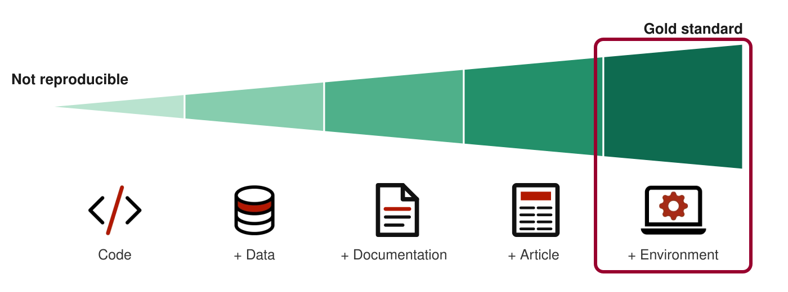{fig-align="center" width="820"}
:::

::: notes
Hand-off: So it's not as simple as having the data and the code. This definition says what it actually takes: the same input data, the same code and steps, *and* the same **conditions of analysis**, meaning the environment it ran in: R version, packages, system. The demo had the first four. It failed on the last one: a different R version. That is what the rest of the talk is about. In practice, reproducibility isn't yes-or-no; every piece you share gets you closer. So it helps to think of it as a spectrum. [click: spectrum]

The vocabulary for the rest of the talk: code, then data, then documentation, then the article, then the environment. Each step gets you closer to the gold standard. Keep this ladder in mind: each study coming up breaks at a different step.
:::

[^schultze]: Schultze, A., Saul, L., Roesch, E., et al. (2026). *Computational reproducibility: A primer from UKRN*. Zenodo. <https://doi.org/10.5281/zenodo.19232891>

## Psychology: about half reproduce[^miske1] {#sec-howdoing}

::: {.nonincremental}
- SCORE: 600 papers, 62 journals, several fields (2009-2018)
- Out of 600 papers, 144 made data available; for 38 more, they obtained source data
:::

::: {.fragment}
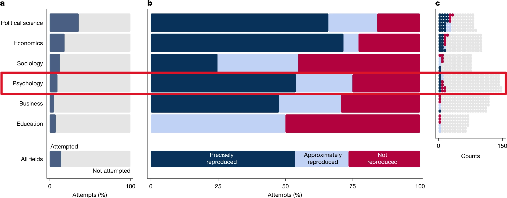{fig-align="center"}
:::

[^miske1]: Miske, O., Abatayo, A. L., Daley, M., et al. (2026). Investigating the reproducibility of the social and behavioural sciences. *Nature*, *652*, 126–134. <https://doi.org/10.1038/s41586-026-10203-5>

::: notes
Transition from the demo: that failure isn't just me. Here's the data.

Panel b: of the psychology papers the teams could attempt, roughly half were precisely reproduced. Mid-pack across fields.

Bridge (point at panel a): "About half reproduced, but half of *what*? Look at panel a: that dark sliver is the only part of psychology anyone could even try. Everything grey is papers nobody could check. Why so few? You can't attempt a reproduction without data." -> next slide

(An "attempt" = an analyst actually tried to reanalyse the paper, which needed author data, author data + code, or reconstructable source data. Panel a: attempted out of all sampled papers. Panel b: outcomes out of attempted papers only.)
:::

## Why so few attempts? No data[^miske2] {#sec-howdoing-avail}

::: {.nonincremental}
- Few psychology papers shared both data and code
:::

::: {.fragment}
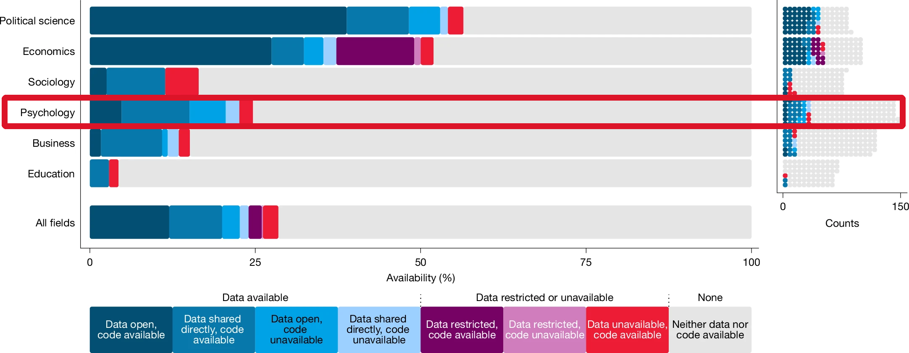{fig-align="center" width="740"}
:::

[^miske2]: Miske, O., Abatayo, A. L., Daley, M., et al. (2026). Investigating the reproducibility of the social and behavioural sciences. *Nature*, *652*, 126–134. <https://doi.org/10.1038/s41586-026-10203-5>

::: notes
Psychology row: only around a quarter of papers had data available in any form, and only a small slice had open data plus code. The rest can't be checked at all.

So the ~50% is a best case, among the papers that shared. Hand-off: and when materials are shared, are they actually usable? -> Quintana
:::

## Shared ≠ usable {#sec-osf-repro}

::::: columns
::: {.column width="32%"}
- Quintana (2026)[^quintana]

- Downloaded materials from OSF repos (334 papers)

  - *Psych Sci*, *JML*, and *ESP*

  - When materials are shared, are they usable?
:::

::: {.column width="68%"}
::: {.fragment}
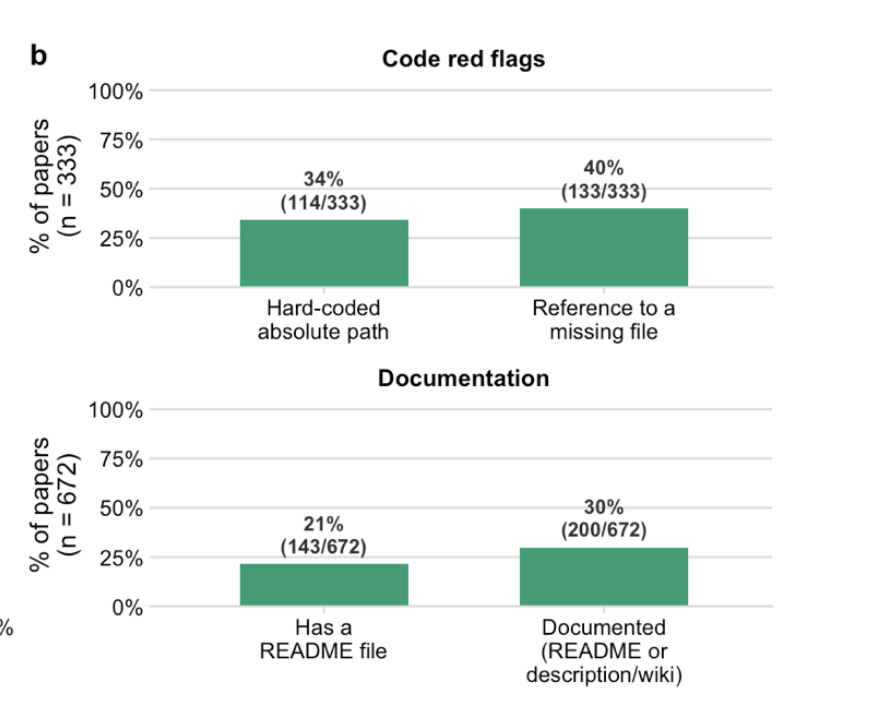{fig-align="center" height="420"}
:::
:::
:::::

[^quintana]: Quintana, D. S. (2026, September 19). Shared research materials in psychology are widely downloaded but often difficult to reuse. PsyArXiv. <https://osf.io/preprints/psyarxiv/yswku_v3>

## READMEs help, but only so far {#sec-readme-repro}

::: {.nonincremental}
- Institute for Replication[^Brodeur]: 67 *Psych Science* papers (2024-2025)
:::

::: {.fragment}
```{r}
#| label: readme-repro
#| echo: false
#| message: false
#| warning: false
#| fig-width: 13
#| fig-height: 5.5
#| fig-align: center
#| out-width: 820px
#| dpi: 300
#| dev: ragg_png
# Brodeur, Abdul Baki, & Fazio (2026), Table 9
library(ggplot2)
library(tidyr)
suppressMessages(library(dplyr))

# Conditional percentages within each README group (rows sum to 100)
tab9 <- tribble(
  ~readme   , ~outcome                          , ~Fully , ~Partially , ~No    ,
  "none"    , "Raw data"                        , 36.364 , 22.727     , 40.909 ,
  "none"    , "Analysis data"                   , 72.727 , 22.727     ,  4.545 ,
  "none"    , "Cleaning code"                   , 36.364 , 22.727     , 40.909 ,
  "none"    , "Analysis code"                   , 59.091 , 31.818     ,  9.091 ,
  "none"    , "Reproducible from raw data"      , 27.273 , 27.273     , 45.455 ,
  "none"    , "Reproducible from analysis data" , 50.000 , 45.455     ,  4.545 ,
  "clear"   , "Raw data"                        , 56.250 , 18.750     , 25.000 ,
  "clear"   , "Analysis data"                   , 81.250 , 12.500     ,  6.250 ,
  "clear"   , "Cleaning code"                   , 50.000 , 18.750     , 31.250 ,
  "clear"   , "Analysis code"                   , 81.250 , 12.500     ,  6.250 ,
  "clear"   , "Reproducible from raw data"      , 31.250 , 37.500     , 31.250 ,
  "clear"   , "Reproducible from analysis data" , 87.500 ,  6.250     ,  6.250 ,
  "unclear" , "Raw data"                        , 48.276 , 31.034     , 20.690 ,
  "unclear" , "Analysis data"                   , 72.414 , 17.241     , 10.345 ,
  "unclear" , "Cleaning code"                   , 51.724 , 27.586     , 20.690 ,
  "unclear" , "Analysis code"                   , 72.414 , 27.586     ,  0.000 ,
  "unclear" , "Reproducible from raw data"      , 27.586 , 37.931     , 34.483 ,
  "unclear" , "Reproducible from analysis data" , 48.276 , 37.931     , 13.793
)

readme_labels <- c(
  none = "A: No README (n = 22)",
  clear = "B: Clear README (n = 16)",
  unclear = "C: Unclear README (n = 29)"
)

plot_df <- tab9 |>
  pivot_longer(Fully:No, names_to = "status", values_to = "pct") |>
  mutate(
    status = factor(status, levels = c("Fully", "Partially", "No")),
    readme = factor(readme_labels[readme], levels = readme_labels),
    # first level plots at the bottom, so reverse to read top-down
    outcome = factor(outcome, levels = rev(unique(tab9$outcome))),
    label = ifelse(pct >= 10, paste0(floor(pct + 0.5), "%"), "")
  )

# Box the two reproducibility rows in Panel B (clear README):
# 88% from analysis data vs. 31% from raw data
highlight_box <- tibble(
  readme = factor(readme_labels["clear"], levels = readme_labels),
  xmin = -1.5,
  xmax = 101.5,
  ymin = 0.5,
  ymax = 2.5
)

bc_colors <- c(Fully = "#98002E", Partially = "#BC9B6A", No = "#D9D9D9")
label_ink <- c(Fully = "white", Partially = "#1A1A1A", No = "#1A1A1A")

p <- ggplot(plot_df, aes(x = pct, y = outcome, fill = status)) +
  geom_col(
    position = position_stack(reverse = TRUE),
    width = 0.72,
    color = "white",
    linewidth = 0.6
  ) +
  geom_text(
    aes(label = label, color = status),
    position = position_stack(vjust = 0.5, reverse = TRUE),
    size = 3.6,
    fontface = "bold",
    show.legend = FALSE
  ) +
  geom_rect(
    data = highlight_box,
    inherit.aes = FALSE,
    aes(xmin = xmin, xmax = xmax, ymin = ymin, ymax = ymax),
    fill = NA,
    color = "#dc1428",
    linewidth = 1.6
  ) +
  facet_wrap(~readme, ncol = 3) +
  coord_cartesian(clip = "off") +
  scale_fill_manual(values = bc_colors, name = NULL) +
  scale_color_manual(values = label_ink, guide = "none") +
  # every bar sums to 100% and segments are labeled, so no x-axis needed
  scale_x_continuous(expand = c(0, 0), breaks = NULL) +
  labs(x = NULL, y = NULL) +
  theme_minimal(base_size = 16, base_family = "Helvetica") +
  theme(
    legend.position = "top",
    legend.justification = "left",
    legend.key.size = unit(0.5, "cm"),
    strip.text = element_text(face = "bold", hjust = 0, size = 15),
    axis.text.y = element_text(color = "#1A1A1A"),
    panel.grid = element_blank(),
    panel.spacing.x = unit(0.8, "cm"),
    plot.margin = margin(10, 30, 10, 10),
    plot.background = element_rect(fill = "white", color = NA)
  )

p
```
:::

::: {.fragment}
- Clear README: **88%** from analysis data, only **31%** from raw data
:::

::: notes
Brodeur et al.: 67 teams each reproduced one of 67 Psych Sci articles (2024-2025). Overall, 58.2% fully reproducible from the final analysis data, but only 28.4% from raw data.

Point to panel B, bottom row: a clear README takes "reproducible from analysis data" from 50% to 88%. Documentation fixes "what do I run?"

Then panel B, second-to-last row: from raw data, a clear README gets 31%, about the same as no README (27%). Documentation doesn't fix "it won't run on my machine."

Hand-off: so where does that leave us? Back to the spectrum. -> Psychology: not so good
:::

[^Brodeur]: Brodeur, A., Abdul Baki, G., & Fazio, L. (2026). Mass reproducibility in psychological science.

## Psychology: not so good 😟 {#sec-spectrum-recap}

::: {.nonincremental}
- Back to the spectrum: where do these studies leave us?
:::

::: {.fragment}
{fig-align="center" width="820"}
:::

::: {.fragment}
- Code, data, and a README get you partway. The **environment** is the missing step.
:::

::: notes
Bring the spectrum back and place the studies on it:
- SCORE: most papers never get past "code + data": nothing shared, nothing to check.
- Quintana: materials are shared, but hard to reuse.
- Brodeur / I4R: a clear README gets you to 88% from analysis data, but from raw data it's 31%, no better than no README.

What's left is the last box: the computational environment. That's the rest of this talk.
:::

# The Computational Environment

## Which "reproducible"?[^grid1] {#sec-repro-blocks}

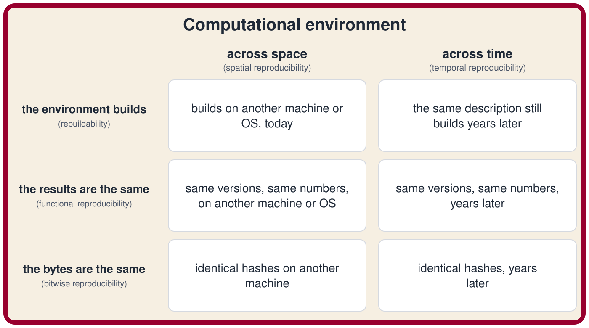{.hex fig-align="center"}

::: notes
Transition: we just landed on the last box of the spectrum, the environment. But what does "my environment is reproducible" actually mean?

Grid (don't read every cell): two directions, across space (another machine/OS, today) and across time (years from now). Three levels: the build succeeds, the result is the same, the bytes are the same (strictest; numbers later on the Malka et al. slide).

Punchline: most tools cover only one or two of these six boxes. The question isn't "is it reproducible?" but "WHICH BOXES?" When we get to specific tools later, we'll come back to this grid.

Hand-off: "Let's start with how the environment breaks." -> Environment Fragility
:::

[^grid1]: Adapted from \[ADD SOURCE\]

## Environment Fragility

Setting bitwise reproducibility aside, even error-free R code sits on top of four layers, each of which may drift over space and time:

1.  **R version**
2.  **R packages**
3.  **Document tools**: e.g., Pandoc, LaTeX, Quarto
4.  **System libraries and compilers**: e.g., gcc, libpng, BLAS/LAPACK

::: notes
What the layer-4 examples are (none of them are R packages, so no R tool tracks them):

- **gcc**: the C/C++/Fortran compiler. Many R packages (and every Stan model) ship as source code that gcc turns into machine code on your computer. A different gcc version can refuse to compile old code, or compile it slightly differently.
- **libpng**: the operating system's library for reading and writing PNG images. R's `png()` device and packages like ragg call it to save plots.
- **BLAS/LAPACK**: the linear-algebra libraries underneath R's matrix math (`%*%`, `crossprod()`, `solve()`, `chol()`, `eigen()`, `svd()`). There are several interchangeable versions (reference BLAS, OpenBLAS, Apple Accelerate, Intel MKL); they add numbers in different orders, so results can differ in the last decimal places, or an eigenvector can flip sign (the example coming up).
:::

## 1. R version {#sec-env-r}

- **Syntax**: the native pipe `|>` exists only since R 4.1.0.
- **Defaults**: R 4.0.0 stopped turning strings into factors. Same code, different object:

::: {.fragment}
``` r
df <- data.frame(group = c("a", "b"))
class(df$group); as.numeric(df$group)
#> R 3.6.3:  "factor"      1  2   (stringsAsFactors = TRUE)
#> R 4.0.0+: "character"  NA NA   (stringsAsFactors = FALSE)
```
:::

- **Random numbers**: R 3.6.0 changed how `sample()` draws. Same seed, different draws:

::: {.fragment}
``` r
set.seed(123); sample(1:10, 3)
#> R 3.5.3:   3  8  4    (sample.kind = "Rounding")
#> R 3.6.0+:  3 10  2    (sample.kind = "Rejection")
```
:::

## 2. R packages {#sec-env-pkgs}

- **Renamed or deprecated**: `dplyr::cur_data()`, but now `dplyr::pick()` (warning about the future).
- **Internal functions** (discouraged, but used nonetheless):

## 3. Document tools {#sec-env-docs}

- Pandoc and LaTeX, called by Quarto (also outside R) or by `{rmarkdown}`. Each has its own version.
- From this talk's demo: HTML fine, PDF failed until one more LaTeX package was declared:

::: {.fragment}
```         
LaTeX Error: File `lualatex-math.sty' not found.
```
:::

## 4. System libraries and compilers {#sec-env-sys}

- Many R packages are compiled code (C, C++, Fortran) and use libraries from the OS (e.g., libpng, BLAS/LAPACK).
  - Today: CRAN hands you a binary. However, years later: only the source. Your machine compiles it, with today's compiler and today's libraries.
- Same script, different BLAS (illustration in next slides).

## 4. System libraries and compilers (continued) {#sec-env-sys2 .code-walk}

- Based on an illustration by Danielle Navarro; eigenvector sign flip in the system's BLAS/LAPACK (`MASS::mvrnorm()` is not invariant, `mvtnorm::rmvnorm()` fine).

::: {.fragment}
```         
== MASS (native R) ==
  macOS:    0.28780065222640439   0.59425558497432929  -0.25961849316812602  -2.3918999759288693
  Ubuntu:  -0.43918332712576574   0.25608933342594919   0.85420518537273971  -2.2883238259260961
  Windows: -0.43918332712576580   0.25608933342594914   0.85420518537273971  -2.2883238259260965
  => DIVERGE
```
:::

## Python, too: language version {#sec-py-version .smaller}

- **Syntax**: `match` statements exist only since Python 3.10, the walrus `:=` since 3.8.
- **Random numbers**: sampling from a set works in 3.10, but the draws depend on set order, which changes *every run*. In 3.11+ it errors:

::: {.fragment}
``` python
import random; random.seed(1); random.sample({"a", "b", "c"}, 2)
#> Python 3.10:  ['a', 'b']   (or ['c', 'a'], ... depends on the run)
#> Python 3.11+: TypeError: Population must be a sequence.
```
:::

## Python, too: packages {#sec-py-pkgs .smaller}

- **Changed defaults, loud**: pandas 2.0 stopped silently dropping text columns:

::: {.fragment}
``` python
df = pd.DataFrame({"group": ["a", "a", "b"],
                   "subject": ["s1", "s2", "s3"], "rt": [500, 520, 610]})
df.groupby("group").mean()
#> pandas 1.5: mean rt per group    (subject column quietly dropped)
#> pandas 2.0+: TypeError: agg function failed [how->mean,dtype->object]
```
:::

- **Changed defaults, silent**: numpy 2.0 changed type promotion. No error, different number:

::: {.fragment}
``` python
x = np.float32(0.1) + 0.2
#> numpy 1.26: 0.30000000149011613   (float64)
#> numpy 2.0+: 0.3                   (float32)
```
:::

- **Removed**: `np.float` was removed in numpy 1.24, `DataFrame.append()` in pandas 2.0.
- **Models**: scikit-learn 0.22 changed `LogisticRegression`'s default solver (`liblinear` → `lbfgs`): same call, different coefficients.
- **System libraries**: numpy links OpenBLAS, MKL, or Apple Accelerate depending on how it was installed: the same BLAS story as R.

## Managing the environment {#sec-env-tools}

- Issue: combining incomplete tools (i.e., stabilize parts of it), which may require diverse expertise (e.g., `{renv}`, `{groundhog}`, `{rang}`, `{rig}`, and Docker).

- More complicated with other programming languages (e.g., Julia and Python).
  - uv in python seems to work well

## `{renv}` {#sec-renv}

::::: columns
::: {.column width="72%"}
- Most popular package for reproducibility, and very easy to use:

  - `renv::init()` snapshots the packages used (and their versions) into `renv.lock`

  - `renv::restore()` reinstalls them

- **But** it records, and does not restore, the version of R (can use {rig})

- **But** installing old packages can fail (missing OS dependencies)
:::

::: {.column width="28%"}
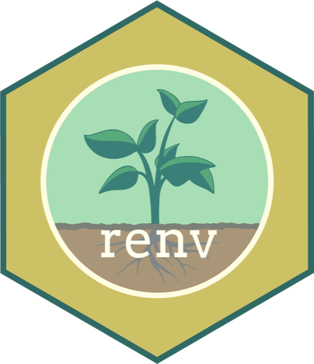{.hex fig-align="center" width="220"}
:::
:::::

## `{renv}` in action {#sec-renv-demo .smaller}

:::::: columns
::: {.column width="50%"}
```r
# analysis.R uses palmerpenguins + ggplot2
renv::init()
```
```
- Linking packages into the project
  library ... Done!
The following package(s) will be
updated in the lockfile:

# CRAN ----------------------------
- cli              [* -> 3.6.6]
- ggplot2          [* -> 4.0.3]
- palmerpenguins   [* -> 0.1.1]
- rlang            [* -> 1.3.0]
  ... 15 more dependencies

The version of R recorded in the lockfile
will be updated:
- R                [* -> 4.6.1]

- Lockfile written to "renv.lock".
```
:::

::: {.column .fragment width="50%"}
`renv.lock` (excerpt)

```json
{
  "R": {
    "Version": "4.6.1",
    "Repositories": [ ... ]
  },
  "Packages": {
    "ggplot2": {
      "Package": "ggplot2",
      "Version": "4.0.3",
      "Source": "Repository",
      "Repository": "CRAN"
    },
    ...
```

R 4.6.1 is **written down**, not installed. `renv::restore()` uses whatever R you have.
:::
::::::

::: notes
Real output from renv 1.2.3 on R 4.6.1 (macOS), lightly trimmed: 19 packages snapshotted for two library() calls. Point at the R line: renv records the R version, but restore() won't give you that R. Links back to the demo: the lockfile would have said R 3.5.3, and restore() on R 4.6 would still give the flipped CI.
:::

## `{renv}`: which boxes? {#sec-renv-boxes}

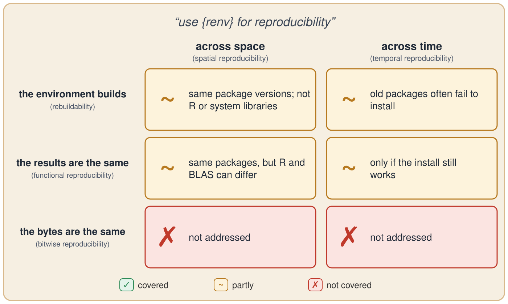{.hex fig-align="center"}

::: notes
renv pins package versions, but not R itself or the system libraries underneath, so everything is "partly". Bitwise isn't addressed.
:::

## Docker: what a container does {#sec-docker}

::::: columns
::: {.column width="86%"}
**Dockerfile** (recipe) $\rightarrow$ **image** (the environment, frozen) $\rightarrow$ **container** (the image, running)[^rladies]
:::

::: {.column width="14%"}
{.hex fig-align="center" width="90"}
:::
:::::

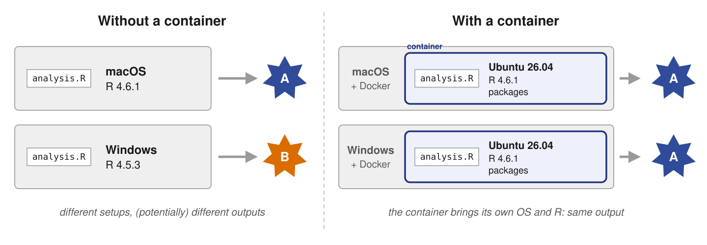{fig-align="center"}

[^rladies]: Figure adapted from Rodrigues, B. *Building reproducible pipelines with R, Docker and Nix*. R-Ladies Rome (English).

## Docker: built for shipping {#sec-docker-issues .code-walk}

- Docker's job: make software run the same on a laptop and a server **today**. Reproducing a result **years later** was never the goal.

::: {.fragment}
**The recipe drifts**: every line fetches what's current *on build day*

``` dockerfile
FROM rocker/r-ver:latest                    # which R? whatever "latest" means today
RUN apt-get update && apt-get install -y libxml2-dev   # today's Ubuntu libraries
RUN Rscript -e 'install.packages("brms")'   # today's CRAN
```
:::

::: notes
Docker was designed for deployment: ship an app so it runs identically across machines right now. Rebuild the same Dockerfile next year and you get a different R, different system libraries, different CRAN. Only the built image is frozen. -> so you have to keep the image
:::

## Docker: the catches {#sec-docker-image}

1.  **Archive the image**
    - Often several GB; tags on Docker Hub can move or vanish

1.  **Same image, different CPU**
    - Runs on the host's processor; OpenBLAS picks code per CPU, so last digits can differ

1.  **Costs**
    - Linux know-how, slow emulation on Apple Silicon, often banned on university clusters, one company in charge

::: notes
Lower-effort alternatives people ask about: Code Ocean (https://codeocean.com/, paid) and Binder (free, can be set up within a manuscript).
:::

## Docker: which boxes? {#sec-docker-boxes}

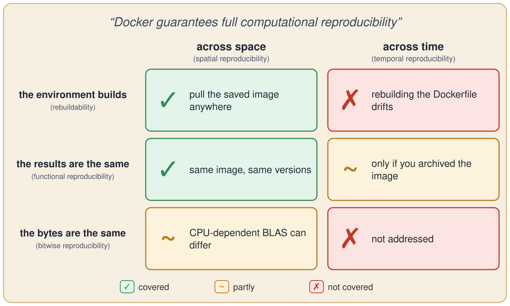{.hex fig-align="center"}

::: notes
Strong across space: pull the saved image anywhere. Weak across time: rebuilding the Dockerfile drifts; results only survive if you archived the image.
:::

## Nix/{Rix} {#sec-nix-intro}

- **Nix** is a package manager (+language +buid tool): 
    - it installs and manages R/Python packages and software/system dependeiences
    - Built for reproducible builds: R, R packages *and* system dependencies, all declared in one text file (a *Nix expression*)
    - Every input is pinned by hash: the same expression gives the same environment, on any machine (everything lives in its own folder)
      - The "+ Environment" step of the gold standard

## Nix is like an app store {#sec-nix-appstore}

::::: columns
::: {.column width="60%"}
- Like an **app store** on your phone, but for research software
- One catalog (`nixpkgs`): R, R packages, Quarto, CmdStan, system libraries
- Your `default.nix` is the list of "apps" to install
- The twist: the store is **frozen on a date**. No auto-updates, so everyone gets the exact same versions
:::

::: {.column width="40%"}
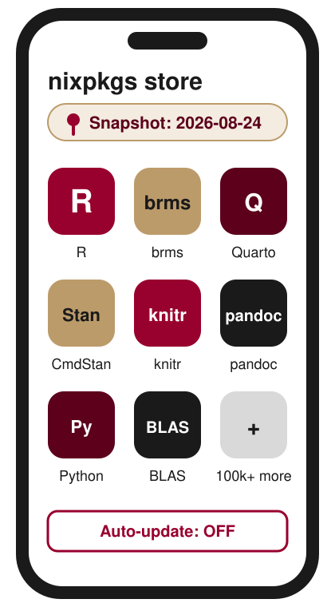{fig-align="center" height="520"}
:::
:::::

::: notes
Everyone knows the phone version: open the store, pick your apps, they install. The problem is that your phone auto-updates, and so does CRAN. Install brms today and next year and you get different versions.

Nix is the same idea with one change: you choose a snapshot date, and the whole store is frozen at that date. Anyone who installs from the 2026-08-24 store, on any machine, next month or in five years, gets exactly the same apps.

Hand-off: how big is this store? -> size slide
:::

## How big is `nixpkgs`?[^repology] {#sec-nix-size}

::: {.nonincremental}
- `nixpkgs` (top right): biggest, freshest; nearly all of CRAN ([search](https://search.nixos.org/packages))
:::

::: {.fragment}
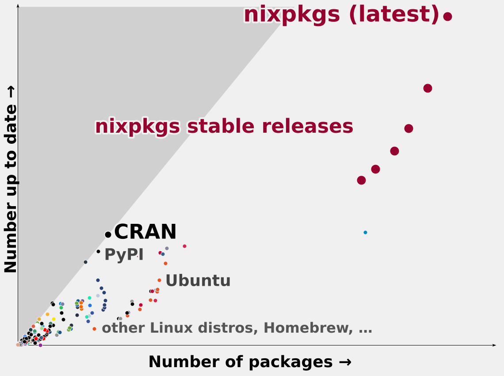{fig-align="center" height="440"}
:::

::: notes
Repology plots every package repository: x = how many packages, y = how many are up to date. nixpkgs (the maroon dots, top right: the latest branch plus each stable release) beats everything, including CRAN itself (labelled, lower left).

Nearly all of CRAN and Bioconductor is in there, prebuilt. Prebuilt binaries come from a cache, so installs are fast enough for daily work. Nix also works without root access, e.g., on an HPC cluster.
:::

[^repology]: Source: <https://repology.org/repositories/graphs> (retrieved November 2026).

## Nix: the empirical evidence {#sec-nix-evidence}

Malka, Zacchiroli, & Zimmermann (2025)[^malka] rebuilt **709,816 packages** from `nixpkgs` snapshots taken every four months, 2017–2023:

- **Rebuildable**: 99.7% to 99.9% still build from their description.
- **Bitwise reproducible**: 69% in 2017, 91% in 2023, rising.
- **Functionally reproducible**: not measured, but follows for every package that rebuilds. From my understanding, every input is pinned by hash, so a rebuild can fail but cannot succeed with different versions. This is not the same with Docker.

[^malka]: Malka, J., Zacchiroli, S., & Zimmermann, T. (2025). Does functional package management enable reproducible builds at scale? Yes. *2025 IEEE/ACM 22nd International Conference on Mining Software Repositories (MSR)*. <https://doi.org/10.1109/MSR66628.2025.00115>

## Nix: which boxes? {#sec-nix-boxes}

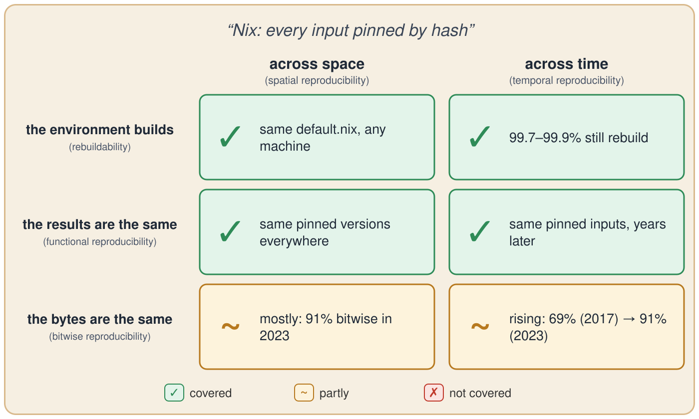{.hex fig-align="center"}

::: notes
Numbers from the previous slide (Malka et al.): rebuildable 99.7-99.9%; bitwise 69% (2017) to 91% (2023). The one "partly" is the strictest level.
:::

## Nix: a Nix expression (`default.nix`) {#sec-rix-nix .code-walk}

``` {.nix code-line-numbers="2-3"}
let
  pkgs = import (fetchTarball
    "https://github.com/rstats-on-nix/nixpkgs/archive/2026-08-24.tar.gz") {};
  rpkgs = builtins.attrValues {
    inherit (pkgs.rPackages) brms knitr palmerpenguins rmarkdown;
  };
  cmdstanr = pkgs.rPackages.buildRPackage {
    name = "cmdstanr";
    src = pkgs.fetchgit {
      url    = "https://github.com/stan-dev/cmdstanr";
      rev    = "da99e2ba954658bdad63bffb738c4444c33a4e0e";
      sha256 = "sha256-wXfOxBexnuL83fvCM+6qv6d7UhTLGq+Xhvja3lRfQpI=";
    };
  };
  system_packages = builtins.attrValues {
    inherit (pkgs) cmdstan pandoc quarto R;
  };
  shell = pkgs.mkShell {
    buildInputs = [ cmdstanr rpkgs system_packages ];
    shellHook   = "export CMDSTAN=...";
  };
in { inherit pkgs shell; }
```

**The snapshot**: every package definition comes from nixpkgs as it was on 2026-08-24.

## Nix: a Nix expression (`default.nix`) {.code-walk}

``` {.nix code-line-numbers="4-6"}
let
  pkgs = import (fetchTarball
    "https://github.com/rstats-on-nix/nixpkgs/archive/2026-08-24.tar.gz") {};
  rpkgs = builtins.attrValues {
    inherit (pkgs.rPackages) brms knitr palmerpenguins rmarkdown;
  };
  cmdstanr = pkgs.rPackages.buildRPackage {
    name = "cmdstanr";
    src = pkgs.fetchgit {
      url    = "https://github.com/stan-dev/cmdstanr";
      rev    = "da99e2ba954658bdad63bffb738c4444c33a4e0e";
      sha256 = "sha256-wXfOxBexnuL83fvCM+6qv6d7UhTLGq+Xhvja3lRfQpI=";
    };
  };
  system_packages = builtins.attrValues {
    inherit (pkgs) cmdstan pandoc quarto R;
  };
  shell = pkgs.mkShell {
    buildInputs = [ cmdstanr rpkgs system_packages ];
    shellHook   = "export CMDSTAN=...";
  };
in { inherit pkgs shell; }
```

**R packages** from that snapshot: exact versions, plus all of their dependencies.

## Nix: a Nix expression (`default.nix`) {#sec-nix-cmdstanr .code-walk}

``` {.nix code-line-numbers="7-14"}
let
  pkgs = import (fetchTarball
    "https://github.com/rstats-on-nix/nixpkgs/archive/2026-08-24.tar.gz") {};
  rpkgs = builtins.attrValues {
    inherit (pkgs.rPackages) brms knitr palmerpenguins rmarkdown;
  };
  cmdstanr = pkgs.rPackages.buildRPackage {
    name = "cmdstanr";
    src = pkgs.fetchgit {
      url    = "https://github.com/stan-dev/cmdstanr";
      rev    = "da99e2ba954658bdad63bffb738c4444c33a4e0e";
      sha256 = "sha256-wXfOxBexnuL83fvCM+6qv6d7UhTLGq+Xhvja3lRfQpI=";
    };
  };
  system_packages = builtins.attrValues {
    inherit (pkgs) cmdstan pandoc quarto R;
  };
  shell = pkgs.mkShell {
    buildInputs = [ cmdstanr rpkgs system_packages ];
    shellHook   = "export CMDSTAN=...";
  };
in { inherit pkgs shell; }
```

**cmdstanr from GitHub**: exact commit *and* content hash. If GitHub changes, the build fails rather than silently differing. By hand, you compute that hash yourself.

## Nix: a Nix expression (`default.nix`) {.code-walk}

``` {.nix code-line-numbers="15-17"}
let
  pkgs = import (fetchTarball
    "https://github.com/rstats-on-nix/nixpkgs/archive/2026-08-24.tar.gz") {};
  rpkgs = builtins.attrValues {
    inherit (pkgs.rPackages) brms knitr palmerpenguins rmarkdown;
  };
  cmdstanr = pkgs.rPackages.buildRPackage {
    name = "cmdstanr";
    src = pkgs.fetchgit {
      url    = "https://github.com/stan-dev/cmdstanr";
      rev    = "da99e2ba954658bdad63bffb738c4444c33a4e0e";
      sha256 = "sha256-wXfOxBexnuL83fvCM+6qv6d7UhTLGq+Xhvja3lRfQpI=";
    };
  };
  system_packages = builtins.attrValues {
    inherit (pkgs) cmdstan pandoc quarto R;
  };
  shell = pkgs.mkShell {
    buildInputs = [ cmdstanr rpkgs system_packages ];
    shellHook   = "export CMDSTAN=...";
  };
in { inherit pkgs shell; }
```

**System software**: R itself, Quarto, pandoc and CmdStan, from the same snapshot.

## Nix: a Nix expression (`default.nix`) {#sec-nix-shell .code-walk}

``` {.nix code-line-numbers="18-21"}
let
  pkgs = import (fetchTarball
    "https://github.com/rstats-on-nix/nixpkgs/archive/2026-08-24.tar.gz") {};
  rpkgs = builtins.attrValues {
    inherit (pkgs.rPackages) brms knitr palmerpenguins rmarkdown;
  };
  cmdstanr = pkgs.rPackages.buildRPackage {
    name = "cmdstanr";
    src = pkgs.fetchgit {
      url    = "https://github.com/stan-dev/cmdstanr";
      rev    = "da99e2ba954658bdad63bffb738c4444c33a4e0e";
      sha256 = "sha256-wXfOxBexnuL83fvCM+6qv6d7UhTLGq+Xhvja3lRfQpI=";
    };
  };
  system_packages = builtins.attrValues {
    inherit (pkgs) cmdstan pandoc quarto R;
  };
  shell = pkgs.mkShell {
    buildInputs = [ cmdstanr rpkgs system_packages ];
    shellHook   = "export CMDSTAN=...";
  };
in { inherit pkgs shell; }
```

**The shell**: everything above, bundled into what `nix-shell` opens. By hand, this means learning Nix. `{rix}` writes it for you, from R.

## Nix/`Rix` {#sec-rix-intro .code-walk}

::::: columns
::: {.column width="78%"}
- `{rix}`, by Bruno Rodrigues ([website](https://docs.ropensci.org/rix/)), makes writing Nix expressions easy: one R function, `rix()`
:::

::: {.column width="22%"}
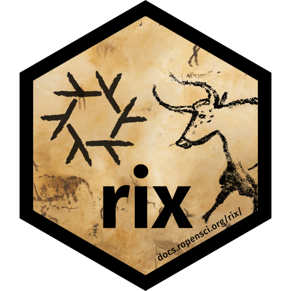{.hex fig-align="center" width="150"}
:::
:::::

::: {.fragment}
``` r
install.packages("rix", repos = "https://ropensci.r-universe.dev")
```
:::

## Nix/`Rix`: the `rix()` call {#sec-rix-call .code-walk}

``` {.r code-line-numbers="4"}
library(rix)

rix(
  date   = "2026-08-24",
  r_pkgs = c("brms", "palmerpenguins", "knitr", "rmarkdown"),
  git_pkgs = list(
    package_name = "cmdstanr",
    repo_url     = "https://github.com/stan-dev/cmdstanr",
    commit       = "da99e2ba954658bdad63bffb738c4444c33a4e0e"
  ),
  system_pkgs = c("quarto", "cmdstan"),
  shell_hook  = paste(
    "export CMDSTAN=$(dirname $(dirname $(command -v stan)))/opt/cmdstan",
    "export PRECOMPILED_HEADERS=false",
    sep = "\n"
  ),
  ide          = "none",
  project_path = ".",
  overwrite    = TRUE
)
```

**`date`**: becomes the snapshot line in `default.nix`, pinning *everything* to one snapshot of nixpkgs. R and every package come in the versions they had on that day, on any machine, forever.

::: notes
Never hand-edit the generated default.nix: all configuration flows through rix().
:::

## Nix/`Rix`: the `rix()` call {.code-walk}

``` {.r code-line-numbers="5"}
library(rix)

rix(
  date   = "2026-08-24",
  r_pkgs = c("brms", "palmerpenguins", "knitr", "rmarkdown"),
  git_pkgs = list(
    package_name = "cmdstanr",
    repo_url     = "https://github.com/stan-dev/cmdstanr",
    commit       = "da99e2ba954658bdad63bffb738c4444c33a4e0e"
  ),
  system_pkgs = c("quarto", "cmdstan"),
  shell_hook  = paste(
    "export CMDSTAN=$(dirname $(dirname $(command -v stan)))/opt/cmdstan",
    "export PRECOMPILED_HEADERS=false",
    sep = "\n"
  ),
  ide          = "none",
  project_path = ".",
  overwrite    = TRUE
)
```

**`r_pkgs`**: CRAN packages, at their versions on that date. `knitr` and `rmarkdown` are here because Quarto needs them to run R code.

## Nix/`Rix`: the `rix()` call {.code-walk}

``` {.r code-line-numbers="6-10"}
library(rix)

rix(
  date   = "2026-08-24",
  r_pkgs = c("brms", "palmerpenguins", "knitr", "rmarkdown"),
  git_pkgs = list(
    package_name = "cmdstanr",
    repo_url     = "https://github.com/stan-dev/cmdstanr",
    commit       = "da99e2ba954658bdad63bffb738c4444c33a4e0e"
  ),
  system_pkgs = c("quarto", "cmdstan"),
  shell_hook  = paste(
    "export CMDSTAN=$(dirname $(dirname $(command -v stan)))/opt/cmdstan",
    "export PRECOMPILED_HEADERS=false",
    sep = "\n"
  ),
  ide          = "none",
  project_path = ".",
  overwrite    = TRUE
)
```

**`git_pkgs`**: packages that aren't on CRAN. cmdstanr is pinned to an exact commit (the v0.9.0 release), not "whatever is on GitHub today".

## Nix/`Rix`: the `rix()` call {.code-walk}

``` {.r code-line-numbers="11"}
library(rix)

rix(
  date   = "2026-08-24",
  r_pkgs = c("brms", "palmerpenguins", "knitr", "rmarkdown"),
  git_pkgs = list(
    package_name = "cmdstanr",
    repo_url     = "https://github.com/stan-dev/cmdstanr",
    commit       = "da99e2ba954658bdad63bffb738c4444c33a4e0e"
  ),
  system_pkgs = c("quarto", "cmdstan"),
  shell_hook  = paste(
    "export CMDSTAN=$(dirname $(dirname $(command -v stan)))/opt/cmdstan",
    "export PRECOMPILED_HEADERS=false",
    sep = "\n"
  ),
  ide          = "none",
  project_path = ".",
  overwrite    = TRUE
)
```

**`system_pkgs`**: software outside R. Quarto and CmdStan are the two things that broke in the demo; now they're part of the environment.

## Nix/`Rix`: the `rix()` call {.code-walk}

``` {.r code-line-numbers="12-16"}
library(rix)

rix(
  date   = "2026-08-24",
  r_pkgs = c("brms", "palmerpenguins", "knitr", "rmarkdown"),
  git_pkgs = list(
    package_name = "cmdstanr",
    repo_url     = "https://github.com/stan-dev/cmdstanr",
    commit       = "da99e2ba954658bdad63bffb738c4444c33a4e0e"
  ),
  system_pkgs = c("quarto", "cmdstan"),
  shell_hook  = paste(
    "export CMDSTAN=$(dirname $(dirname $(command -v stan)))/opt/cmdstan",
    "export PRECOMPILED_HEADERS=false",
    sep = "\n"
  ),
  ide          = "none",
  project_path = ".",
  overwrite    = TRUE
)
```

**`shell_hook`**: commands that run each time you enter the environment. Here: tell cmdstanr where CmdStan lives.

## Nix/`Rix`: the `rix()` call {.code-walk}

``` {.r code-line-numbers="17-19"}
library(rix)

rix(
  date   = "2026-08-24",
  r_pkgs = c("brms", "palmerpenguins", "knitr", "rmarkdown"),
  git_pkgs = list(
    package_name = "cmdstanr",
    repo_url     = "https://github.com/stan-dev/cmdstanr",
    commit       = "da99e2ba954658bdad63bffb738c4444c33a4e0e"
  ),
  system_pkgs = c("quarto", "cmdstan"),
  shell_hook  = paste(
    "export CMDSTAN=$(dirname $(dirname $(command -v stan)))/opt/cmdstan",
    "export PRECOMPILED_HEADERS=false",
    sep = "\n"
  ),
  ide          = "none",
  project_path = ".",
  overwrite    = TRUE
)
```

**`ide`, `project_path`, `overwrite`**: no IDE (`\"rstudio\"`, `\"positron\"`, `\"code\"` also work); write `default.nix` into this folder.

## Nix/`Rix`: Python too {#sec-rix-python .code-walk}

``` {.r code-line-numbers="4-7"}
rix(
  date    = "2026-08-24",
  r_pkgs  = c("brms", "reticulate"),
  py_conf = list(
    py_version = "3.12",
    py_pkgs    = c("pandas", "numpy")
  ),
  ide          = "none",
  project_path = ".",
  overwrite    = TRUE
)
```

``` bash
$ nix-shell --pure --run 'python --version'
Python 3.12.14                  # pandas 3.0.4, numpy 2.5.1: same 2026-08-24 snapshot
```

**`py_conf`**: one `default.nix` pins R, Python *and* both sets of packages. R reaches that exact Python through `reticulate`, never a system one.

::: notes
Tested on macOS (Apple Silicon): builds and runs with --pure; reticulate calls the pinned numpy.
:::

## Nix/`Rix`: using it {#sec-rix-use}

Install Nix** (macOS, Linux, or Windows via WSL2), using the Determinate Systems installer:

```bash
curl --proto '=https' --tlsv1.2 -sSf -L https://install.determinate.systems/nix | \
  sh -s -- install
```

``` {.bash code-line-numbers="|1|2|3"}
Rscript gen-env.R    # rix() writes default.nix
nix-build            # build it (slow only the first time)
nix-shell --pure --run "quarto render nix_rix_example.qmd"
```

- `--pure`: nothing from your own machine leaks in: not your R, not your packages, not `~/.cmdstan`
- Plain `nix-shell` drops you into the environment to work interactively

::: notes
Live demo here: same repo that failed earlier, now rendering inside the environment. Real-world snags on macOS (Apple Silicon) + Determinate Nix: Quarto/pandoc version mismatches, rstudioWrapper segfaults, binary cache trust config.
:::

# Illustration

```{r}
#| eval: false
#| echo: true
rix(
  date = "2026-08-24",
  r_pkgs = c("brms", "palmerpenguins", "knitr", "rmarkdown"),
  git_pkgs = list(
    package_name = "cmdstanr",
    repo_url = "https://github.com/stan-dev/cmdstanr",
    commit = "da99e2ba954658bdad63bffb738c4444c33a4e0e"
  ),
  system_pkgs = c("quarto", "cmdstan"),
  shell_hook = paste(
    "export CMDSTAN=$(dirname $(dirname $(command -v stan)))/opt/cmdstan",
    "export PRECOMPILED_HEADERS=false",
    sep = "\n"
  ),
  ide = "none",
  project_path = ".",
  overwrite = TRUE
)
```

```{r}
#| eval: false
#| echo: true
#| 
Rscript
gen - env.R # writes default.nix (+ .Rprofile)
nix - build # build the environment once
nix - shell - -pure # enter it
quarto
render
analysis.qmd # render inside it (HTML + PDF)
```

## Nix/`Rix`: using it (recording) {#sec-rix-use-video}

```{=html}
<video src="media/nix-rix-isolation-demo.mp4#t=0.5" controls preload="metadata" style="display:block; width:100%; max-height:72vh; margin:0 auto; border:1px solid #ddd; border-radius:6px;"></video>
```

::: notes
Backup recording (97 s) in case the live demo fails, made in the demo repo (github.com/jgeller112/Rix-Nix_Test). Pause it at each comment line to talk.

1. The analysis: cat nix_rix_example.qmd. Walk through it: palmerpenguins for data, brms for the model, cmdstanr as the backend; one brm() call.
2. Outside Nix: which R is /usr/local/bin/R; R.home() and .libPaths() point at /Library/Frameworks/R.framework, the R that Positron (or RStudio) uses; positron is on the PATH.
3. nix-build: builds the environment in default.nix (written by gen-env.R) and prints its /nix/store path. Fast here because it is cached; a first build downloads from the binary cache and takes minutes.
4. nix-shell --pure, same commands: R is now /nix/store/...-R-4.6.1; 101 library paths, one per package, all in /nix/store (no ~/Library, no system R); positron is not found; the PATH is only /nix/store. Then quarto render builds the brms model with the pinned R, brms, cmdstanr, CmdStan and Quarto.

The "evaluation warning" lines are a harmless Nixpkgs deprecation notice about how rix 0.18.2 writes default.nix.
:::

## Nix not perfect

- Misdeclared dependencies
  - An R package wrongly listed a dependency under Imports when it belonged in Suggests.

- macOS
  - the description stays valid, but an OS update can break today’s build.
    -  Recommendation: build inside a dockerfile.

- Isolation
  - use nix-shell --pure, so the shell sees only the declare environment and not software installed on the host.

- Windows
  - Getting {rix} to work on Windows can be cumbersome
    - Have to use WSL

## What a Lab Can Actually Do

**Not ready for Nix/{Rix}?** Start smaller:

- {renv} and {rig} for R dependency snapshots and R version management
  - {groundhog}  
- Docker for a shared environment
- {targets} for analytic pipelines
- Metacheck (https://www.scienceverse.org/metacheck_book/) allows for a reproduibility check

## Culture, Not Just Tools

- Train RAs 
- Make "can a stranger rerun this?" a lab norm
- Include tools/discussion in courses

## Takeaways {#sec-takeaways}

1.  **Reproducibility is a ladder, not a cliff**
    - Every step you take makes your pipeline more reproducible

1.  **Document it**
    - A clear README: what to run, in what order, starting from raw data

1.  **Freeze the environment**
    - Nix/`{rix}` declares R, packages, and system tools in one file, pinned to a date

## Thanks!

- Interested in learning more about Nix and {rix} check out my tutorial paper with Felipe Vieira and Bruno Rodrigues:

::: {.fragment}
::: callout-note
## Forthcoming in *AMPPS*

Vieira, F. F., Geller, J., & Rodrigues, B. (2026, January 28). Why risk it, when you can {rix} it: A tutorial for computational reproducibility focused on simulation studies. Retrieved from osf.io/preprints/psyarxiv/a3e8v_v1.
:::
:::
