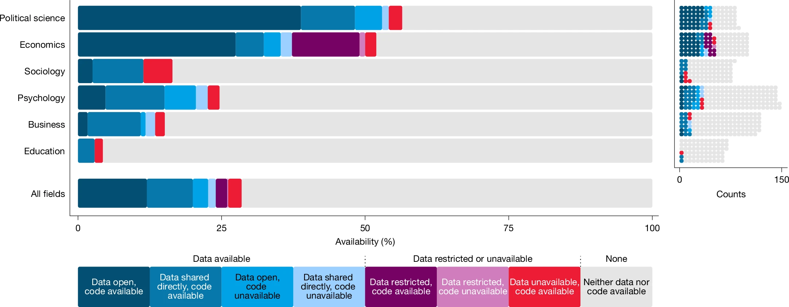
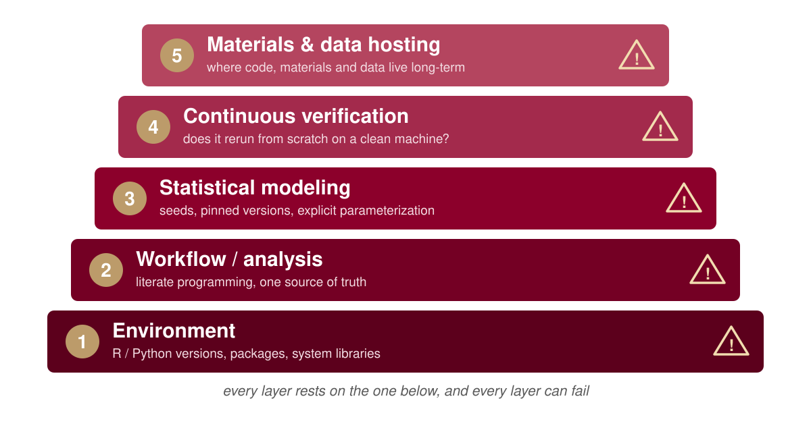

## The Replication Crisis


## ~~Replication Crisis~~ Credibility Revolution!

{fig-align="center" width="320"}

## Open Science

::::: columns
::: {.column width="50%"}
<br>

-   Being open and transparent across all stages of the research process

    -   Key components:

        -   Dissemnation

        -   Stance

        -   ***Workflow***

            -   Is your entire project pipeline reproducible?
:::

::: {.column width="50%"}
<br>

{fig-align="center" width="432"}
:::
:::::

## What is Reproduciblity?

| Analysis / Data    | Same Data        | Different Data    |
|--------------------|------------------|-------------------|
| Same Analysis      | **Reproducible** | **Replicable**    |
| Different Analysis | **Robust**       | **Generalisable** |


## How are we doing?

::::: columns
::: {.column width="32%"}
-   SCORE reproduciibiliy project

    -   600 papers across 62 journals from several different fields examined between 2009-2018
:::

::: {.column width="68%"}
{.bigfig fig-align="center"}
:::
:::::

## How are we doing?

{fig-align="center"}

## How are we doing?

::::: columns
::: {.column width="32%"}
-   [STUDY NAME]

    -   [Sample: N papers / journals / years]

    -   [Key finding]
:::

::: {.column width="68%"}
[FIGURE: add image + citation caption]
:::
:::::

::: notes
PLACEHOLDER: slot for the psych-specific study that motivates "Psychology not so good".
:::

# Psychology not so good 😟

## Reproducibility Spectrum

{fig-align="center"}

## Reproducibility ≠ One Thing

It's a stack, with a failure point at every layer:

{fig-align="center"}

## Enviorment Fragility

Setting bitwise reproducibility aside, even error-free R code sits on top of 
four layers, each of which may drift over space and time:

1. **R version**
2. **R packages**
3. **Document tools**: e.g., Pandoc, LaTeX, Quarto
4. **System libraries and compilers**: e.g., gcc, libpng, BLAS/LAPACK

## 1. R version {#sec-env-r}

- **Syntax**: the native pipe `|>` exists only since R 4.1.0. 
- **Defaults**: R 4.0.0 stopped turning strings into factors. Same code, different object:

```r
df <- data.frame(group = c("a", "b"))
class(df$group); as.numeric(df$group)
#> R 3.6.3:  "factor"      1  2       (stringsAsFactors = TRUE)
#> R 4.0.0+: "character"  NA NA       (stringsAsFactors = FALSE)
```

- **Random numbers**: R 3.6.0 changed how `sample()` draws. Same seed, different draws:

```r
set.seed(123); sample(1:10, 3)
#> R 3.5.3:   3  8  4        (sample.kind = "Rounding")
#> R 3.6.0+:  3 10  2        (sample.kind = "Rejection")
```

## 2. R packages {#sec-env-pkgs}

- **Renamed or deprecated**: `dplyr::cur_data()`, but now `dplyr::pick()` (warning about the future).
- **Internal functions** (discouraged, but used nonetheless):

## 3. Document tools {#sec-env-docs}

- Pandoc and LaTeX, called by Quarto (also outside R) or by `{rmarkdown}`. Each has its own version.
- From this talk's demo: HTML fine, PDF failed until one more LaTeX package was declared:

```
LaTeX Error: File `lualatex-math.sty' not found.
```


## 4. System libraries and compilers {#sec-env-sys}

- Many R packages are compiled code (C, C++, Fortran) and use libraries from the OS (e.g., libpng, BLAS/LAPACK).
  - Today: CRAN hands you a binary. However, years later: only the source. Your machine compiles it, with today's compiler and today's libraries.
- Same script, different BLAS (illustration in next slides).

## 4. System libraries and compilers (continued) {#sec-env-sys2 .code-walk}

- Based on an illustration by Danielle Navarro; eigenvector sign flip in the system's BLAS/LAPACK (`MASS::mvrnorm()` is not invariant, `mvtnorm::rmvnorm()` fine).

```
== MASS (native R) ==
  macOS:    0.28780065222640439   0.59425558497432929  -0.25961849316812602  -2.3918999759288693
  Ubuntu:  -0.43918332712576574   0.25608933342594919   0.85420518537273971  -2.2883238259260961
  Windows: -0.43918332712576580   0.25608933342594914   0.85420518537273971  -2.2883238259260965
  => DIVERGE
```

## Python, too: language version {#sec-py-version .smaller}

- **Syntax**: `match` statements exist only since Python 3.10, the walrus `:=` since 3.8.
- **Random numbers**: sampling from a set works in 3.10, but the draws depend on set order, which changes *every run* (string hashing). In 3.11+ it errors:

```python
import random; random.seed(1); random.sample({"a", "b", "c"}, 2)
#> Python 3.10:  ['a', 'b']   (or ['c', 'a'], ... depends on the run)
#> Python 3.11+: TypeError: Population must be a sequence.  For dicts or sets, use sorted(d).
```

- **Hashing**: same code, same machine, different order each run (unless `PYTHONHASHSEED` is set):

```python
print(list({"apple", "banana", "cherry"}))
#> run 1: ['cherry', 'apple', 'banana']
#> run 2: ['apple', 'cherry', 'banana']
```

## Python, too: packages {#sec-py-pkgs .smaller}

- **Changed defaults, loud**: pandas 2.0 stopped silently dropping text columns:

```python
df = pd.DataFrame({"group": ["a", "a", "b"], "subject": ["s1", "s2", "s3"], "rt": [500, 520, 610]})
df.groupby("group").mean()
#> pandas 1.5: mean rt per group    (subject column quietly dropped)
#> pandas 2.0+: TypeError: agg function failed [how->mean,dtype->object]
```

- **Changed defaults, silent**: numpy 2.0 changed type promotion. No error, different number:

```python
x = np.float32(0.1) + 0.2
#> numpy 1.26: 0.30000000149011613   (float64)
#> numpy 2.0+: 0.3                   (float32)
```

- **Removed**: `np.float` was removed in numpy 1.24, `DataFrame.append()` in pandas 2.0.
- **Models**: scikit-learn 0.22 changed `LogisticRegression`'s default solver (`liblinear` → `lbfgs`): same call, different coefficients.
- **System libraries**: numpy links OpenBLAS, MKL, or Apple Accelerate depending on how it was installed: the same BLAS story as R.

## Live Demo {#sec-demo-video}

```{=html}
<video src="media/rix-demo.mp4#t=0.5" controls preload="metadata" style="display:block; width:100%; max-height:72vh; margin:0 auto; border:1px solid #ddd; border-radius:6px;"></video>
```

::: notes
Backup recording: a "stranger's laptop" (empty home folder, old Quarto 1.3). Three failures: Typst needs Quarto 1.4+, palmerpenguins missing, CmdStan missing.
:::

## Managing the environment {#sec-env-tools}

- Issue: combining incomplete tools (i.e., stabilize parts of it), which may require diverse expertise (e.g., `{renv}`, `{groundhog}`, `{rang}`, `{rig}`, and Docker).

- More complicated with other programming languages (e.g., Julia and Python).

## `Renv` {#sec-renv}

::::: columns
::: {.column width="72%"}
-   Most popular packages for reproducibility, and very easy to use:

    -   Creates a snap shot of packages used (and versions)

        -   Open an R session in the folder containing the scripts

        -   Run `renv::init()` and check the folder for `renv.lock`

        -   Use `renv::restore` to load all packages used at runtime
:::

::: {.column width="28%"}
{.hex fig-align="center" width="220"}
:::
:::::

## `Renv`

-   Records, but does not restore the version of R

-   Installation of old packages can fail (due to missing OS-dependencies)

## Docker: what a container does {#sec-docker}

**Dockerfile** (recipe) $\rightarrow$ **image** (the environment, frozen) $\rightarrow$ **container** (the image, running)

{fig-align="center"}

## Docker {#sec-docker-tradeoffs}

::::: columns
::: {.column width="84%"}
-   Docker is very useful and widely used

-   But the entry cost is high (familiarity with Linux is recommended)

-   Single point of failure (what happens if Docker gets bought, abandoned, etc? **quite unlikely though**)

-   Not actually dealing with reproducibility per se, we’re “abusing” Docker in a way

:::

::: {.column width="16%"}
{.hex fig-align="center" width="140"}
:::
:::::

::: callout-tip
-   Can use Code Ocean instead (<https://codeocean.com/>) - costs money
-   Binder (free) and you can set it up within manuscript
:::


## Nix/{Rix}

-   Nix

    -   Package manager: tool to install and manage *packages*

    -   Package: any piece of software (not just R packages)

## Nix/{Rix}

-   Gold standard of reproducibility: R, R packages and other dependencies must be managed

-   Nix is a package manager actually focused on reproducible builds

-   Nix deals with everything, with one single text file (called a Nix expression)!

    -   These Nix expressions *always* build the exact same output

## Nix, the package manager: size {#sec-nix-size}

{fig-align="center"}

## Nix: the empirical evidence {#sec-nix-evidence}

Malka, Zacchiroli, & Zimmermann (2025) rebuilt **709,816 packages** from `nixpkgs` snapshots taken every four months, 2017–2023:

- **Rebuildable**: 99.7% to 99.9% still build from their description.
- **Bitwise reproducible**: 69% in 2017, 91% in 2023, rising.
- **Functionally reproducible**: not measured, but follows for every package that rebuilds. From my understanding, every input is pinned by hash, so a rebuild can fail but cannot succeed with different versions. This is not the same with Docker.

::: aside
Malka, Zacchiroli, & Zimmermann (2025)
:::

## Nix: a Nix expression (`default.nix`) {#sec-rix-nix .code-walk}

```{.nix code-line-numbers="2-3"}
let
  pkgs = import (fetchTarball
    "https://github.com/rstats-on-nix/nixpkgs/archive/2026-08-24.tar.gz") {};
  rpkgs = builtins.attrValues {
    inherit (pkgs.rPackages) brms knitr palmerpenguins rmarkdown;
  };
  cmdstanr = pkgs.rPackages.buildRPackage {
    name = "cmdstanr";
    src = pkgs.fetchgit {
      url    = "https://github.com/stan-dev/cmdstanr";
      rev    = "da99e2ba954658bdad63bffb738c4444c33a4e0e";
      sha256 = "sha256-wXfOxBexnuL83fvCM+6qv6d7UhTLGq+Xhvja3lRfQpI=";
    };
  };
  system_packages = builtins.attrValues {
    inherit (pkgs) cmdstan pandoc quarto R;
  };
  shell = pkgs.mkShell {
    buildInputs = [ cmdstanr rpkgs system_packages ];
    shellHook   = "export CMDSTAN=...";
  };
in { inherit pkgs shell; }
```

**The snapshot**: every package definition comes from nixpkgs as it was on 2026-08-24.

## Nix: a Nix expression (`default.nix`) {.code-walk}

```{.nix code-line-numbers="4-6"}
let
  pkgs = import (fetchTarball
    "https://github.com/rstats-on-nix/nixpkgs/archive/2026-08-24.tar.gz") {};
  rpkgs = builtins.attrValues {
    inherit (pkgs.rPackages) brms knitr palmerpenguins rmarkdown;
  };
  cmdstanr = pkgs.rPackages.buildRPackage {
    name = "cmdstanr";
    src = pkgs.fetchgit {
      url    = "https://github.com/stan-dev/cmdstanr";
      rev    = "da99e2ba954658bdad63bffb738c4444c33a4e0e";
      sha256 = "sha256-wXfOxBexnuL83fvCM+6qv6d7UhTLGq+Xhvja3lRfQpI=";
    };
  };
  system_packages = builtins.attrValues {
    inherit (pkgs) cmdstan pandoc quarto R;
  };
  shell = pkgs.mkShell {
    buildInputs = [ cmdstanr rpkgs system_packages ];
    shellHook   = "export CMDSTAN=...";
  };
in { inherit pkgs shell; }
```

**R packages** from that snapshot: exact versions, plus all of their dependencies.

## Nix: a Nix expression (`default.nix`) {#sec-nix-cmdstanr .code-walk}

```{.nix code-line-numbers="7-14"}
let
  pkgs = import (fetchTarball
    "https://github.com/rstats-on-nix/nixpkgs/archive/2026-08-24.tar.gz") {};
  rpkgs = builtins.attrValues {
    inherit (pkgs.rPackages) brms knitr palmerpenguins rmarkdown;
  };
  cmdstanr = pkgs.rPackages.buildRPackage {
    name = "cmdstanr";
    src = pkgs.fetchgit {
      url    = "https://github.com/stan-dev/cmdstanr";
      rev    = "da99e2ba954658bdad63bffb738c4444c33a4e0e";
      sha256 = "sha256-wXfOxBexnuL83fvCM+6qv6d7UhTLGq+Xhvja3lRfQpI=";
    };
  };
  system_packages = builtins.attrValues {
    inherit (pkgs) cmdstan pandoc quarto R;
  };
  shell = pkgs.mkShell {
    buildInputs = [ cmdstanr rpkgs system_packages ];
    shellHook   = "export CMDSTAN=...";
  };
in { inherit pkgs shell; }
```

**cmdstanr from GitHub**: exact commit *and* content hash. If GitHub changes, the build fails rather than silently differing. By hand, you compute that hash yourself.

## Nix: a Nix expression (`default.nix`) {.code-walk}

```{.nix code-line-numbers="15-17"}
let
  pkgs = import (fetchTarball
    "https://github.com/rstats-on-nix/nixpkgs/archive/2026-08-24.tar.gz") {};
  rpkgs = builtins.attrValues {
    inherit (pkgs.rPackages) brms knitr palmerpenguins rmarkdown;
  };
  cmdstanr = pkgs.rPackages.buildRPackage {
    name = "cmdstanr";
    src = pkgs.fetchgit {
      url    = "https://github.com/stan-dev/cmdstanr";
      rev    = "da99e2ba954658bdad63bffb738c4444c33a4e0e";
      sha256 = "sha256-wXfOxBexnuL83fvCM+6qv6d7UhTLGq+Xhvja3lRfQpI=";
    };
  };
  system_packages = builtins.attrValues {
    inherit (pkgs) cmdstan pandoc quarto R;
  };
  shell = pkgs.mkShell {
    buildInputs = [ cmdstanr rpkgs system_packages ];
    shellHook   = "export CMDSTAN=...";
  };
in { inherit pkgs shell; }
```

**System software**: R itself, Quarto, pandoc and CmdStan, from the same snapshot.

## Nix: a Nix expression (`default.nix`) {#sec-nix-shell .code-walk}

```{.nix code-line-numbers="18-21"}
let
  pkgs = import (fetchTarball
    "https://github.com/rstats-on-nix/nixpkgs/archive/2026-08-24.tar.gz") {};
  rpkgs = builtins.attrValues {
    inherit (pkgs.rPackages) brms knitr palmerpenguins rmarkdown;
  };
  cmdstanr = pkgs.rPackages.buildRPackage {
    name = "cmdstanr";
    src = pkgs.fetchgit {
      url    = "https://github.com/stan-dev/cmdstanr";
      rev    = "da99e2ba954658bdad63bffb738c4444c33a4e0e";
      sha256 = "sha256-wXfOxBexnuL83fvCM+6qv6d7UhTLGq+Xhvja3lRfQpI=";
    };
  };
  system_packages = builtins.attrValues {
    inherit (pkgs) cmdstan pandoc quarto R;
  };
  shell = pkgs.mkShell {
    buildInputs = [ cmdstanr rpkgs system_packages ];
    shellHook   = "export CMDSTAN=...";
  };
in { inherit pkgs shell; }
```

**The shell**: everything above, bundled into what `nix-shell` opens. By hand, this means learning Nix. `{rix}` writes it for you, from R.

## Nix/`Rix` {#sec-rix-intro .code-walk}

::::: columns
::: {.column width="78%"}
-   `{rix}` ([website](https://docs.ropensci.org/rix/)) makes writing Nix expressions easy: one R function, `rix()`
:::

::: {.column width="22%"}
{.hex fig-align="center" width="150"}
:::
:::::

```{r}
#| eval: false
#| echo: true

install.packages("rix", repos = "https://ropensci.r-universe.dev")

library(rix)

rix(date        = "2025-01-27",                  # date (or R version) wanted
    r_pkgs      = c("brms", "palmerpenguins"),   # R packages
    system_pkgs = NULL,                          # system dependencies
    git_pkgs    = NULL,                          # GitHub packages
    tex_pkgs    = NULL,                          # LaTeX packages
    ide         = "code",                        # rstudio / positron / code
    project_path = ".")                          # where to write default.nix
```

## Nix/`Rix` {#sec-rix-list}

-   List required R version and packages

-   Optionally: more system packages, packages hosted on Github, or LaTeX packages

-   Optionally: an IDE (Rstudio, Radian, VS Code or “other”)

-   Work interactively in an (relavitely) isolated, project-specific and reproducible environment!

## Nix/`Rix`: the `rix()` call {#sec-rix-call .code-walk}

```{.r code-line-numbers="4"}
library(rix)

rix(
  date   = "2026-08-24",
  r_pkgs = c("brms", "palmerpenguins", "knitr", "rmarkdown"),
  git_pkgs = list(
    package_name = "cmdstanr",
    repo_url     = "https://github.com/stan-dev/cmdstanr",
    commit       = "da99e2ba954658bdad63bffb738c4444c33a4e0e"
  ),
  system_pkgs = c("quarto", "cmdstan"),
  shell_hook  = paste(
    "export CMDSTAN=$(dirname $(dirname $(command -v stan)))/opt/cmdstan",
    "export PRECOMPILED_HEADERS=false",
    sep = "\n"
  ),
  ide          = "none",
  project_path = ".",
  overwrite    = TRUE
)
```

**`date`**: becomes the snapshot line in `default.nix`, pinning *everything* to one snapshot of nixpkgs. R and every package come in the versions they had on that day, on any machine, forever.

## Nix/`Rix`: the `rix()` call {.code-walk}

```{.r code-line-numbers="5"}
library(rix)

rix(
  date   = "2026-08-24",
  r_pkgs = c("brms", "palmerpenguins", "knitr", "rmarkdown"),
  git_pkgs = list(
    package_name = "cmdstanr",
    repo_url     = "https://github.com/stan-dev/cmdstanr",
    commit       = "da99e2ba954658bdad63bffb738c4444c33a4e0e"
  ),
  system_pkgs = c("quarto", "cmdstan"),
  shell_hook  = paste(
    "export CMDSTAN=$(dirname $(dirname $(command -v stan)))/opt/cmdstan",
    "export PRECOMPILED_HEADERS=false",
    sep = "\n"
  ),
  ide          = "none",
  project_path = ".",
  overwrite    = TRUE
)
```

**`r_pkgs`**: CRAN packages, at their versions on that date. `knitr` and `rmarkdown` are here because Quarto needs them to run R code.

## Nix/`Rix`: the `rix()` call {.code-walk}

```{.r code-line-numbers="6-10"}
library(rix)

rix(
  date   = "2026-08-24",
  r_pkgs = c("brms", "palmerpenguins", "knitr", "rmarkdown"),
  git_pkgs = list(
    package_name = "cmdstanr",
    repo_url     = "https://github.com/stan-dev/cmdstanr",
    commit       = "da99e2ba954658bdad63bffb738c4444c33a4e0e"
  ),
  system_pkgs = c("quarto", "cmdstan"),
  shell_hook  = paste(
    "export CMDSTAN=$(dirname $(dirname $(command -v stan)))/opt/cmdstan",
    "export PRECOMPILED_HEADERS=false",
    sep = "\n"
  ),
  ide          = "none",
  project_path = ".",
  overwrite    = TRUE
)
```

**`git_pkgs`**: packages that aren't on CRAN. cmdstanr is pinned to an exact commit (the v0.9.0 release), not \"whatever is on GitHub today\".

## Nix/`Rix`: the `rix()` call {.code-walk}

```{.r code-line-numbers="11"}
library(rix)

rix(
  date   = "2026-08-24",
  r_pkgs = c("brms", "palmerpenguins", "knitr", "rmarkdown"),
  git_pkgs = list(
    package_name = "cmdstanr",
    repo_url     = "https://github.com/stan-dev/cmdstanr",
    commit       = "da99e2ba954658bdad63bffb738c4444c33a4e0e"
  ),
  system_pkgs = c("quarto", "cmdstan"),
  shell_hook  = paste(
    "export CMDSTAN=$(dirname $(dirname $(command -v stan)))/opt/cmdstan",
    "export PRECOMPILED_HEADERS=false",
    sep = "\n"
  ),
  ide          = "none",
  project_path = ".",
  overwrite    = TRUE
)
```

**`system_pkgs`**: software outside R. Quarto and CmdStan are the two things that broke in the demo; now they're part of the environment.

## Nix/`Rix`: the `rix()` call {.code-walk}

```{.r code-line-numbers="12-16"}
library(rix)

rix(
  date   = "2026-08-24",
  r_pkgs = c("brms", "palmerpenguins", "knitr", "rmarkdown"),
  git_pkgs = list(
    package_name = "cmdstanr",
    repo_url     = "https://github.com/stan-dev/cmdstanr",
    commit       = "da99e2ba954658bdad63bffb738c4444c33a4e0e"
  ),
  system_pkgs = c("quarto", "cmdstan"),
  shell_hook  = paste(
    "export CMDSTAN=$(dirname $(dirname $(command -v stan)))/opt/cmdstan",
    "export PRECOMPILED_HEADERS=false",
    sep = "\n"
  ),
  ide          = "none",
  project_path = ".",
  overwrite    = TRUE
)
```

**`shell_hook`**: commands that run each time you enter the environment. Here: tell cmdstanr where CmdStan lives.

## Nix/`Rix`: the `rix()` call {.code-walk}

```{.r code-line-numbers="17-19"}
library(rix)

rix(
  date   = "2026-08-24",
  r_pkgs = c("brms", "palmerpenguins", "knitr", "rmarkdown"),
  git_pkgs = list(
    package_name = "cmdstanr",
    repo_url     = "https://github.com/stan-dev/cmdstanr",
    commit       = "da99e2ba954658bdad63bffb738c4444c33a4e0e"
  ),
  system_pkgs = c("quarto", "cmdstan"),
  shell_hook  = paste(
    "export CMDSTAN=$(dirname $(dirname $(command -v stan)))/opt/cmdstan",
    "export PRECOMPILED_HEADERS=false",
    sep = "\n"
  ),
  ide          = "none",
  project_path = ".",
  overwrite    = TRUE
)
```

**`ide`, `project_path`, `overwrite`**: no IDE (`\"rstudio\"`, `\"positron\"`, `\"code\"` also work); write `default.nix` into this folder.

## Nix/`Rix`: Python too {#sec-rix-python .code-walk}

```{.r code-line-numbers="4-7"}
rix(
  date    = "2026-08-24",
  r_pkgs  = c("brms", "reticulate"),
  py_conf = list(
    py_version = "3.12",
    py_pkgs    = c("pandas", "numpy")
  ),
  ide          = "none",
  project_path = ".",
  overwrite    = TRUE
)
```

```{.bash}
$ nix-shell --pure --run 'python --version'
Python 3.12.14                  # pandas 3.0.4, numpy 2.5.1: same 2026-08-24 snapshot
```

**`py_conf`**: one `default.nix` pins R, Python *and* both sets of packages. R reaches that exact Python through `reticulate`, never a system one.

::: notes
Tested on macOS (Apple Silicon): builds and runs with --pure; reticulate calls the pinned numpy.
:::

## Nix/`Rix` {#sec-rix-steps}

-   Steps:

1.  Install Nix on your computer
2.  `rix::rix()` generates a `default.nix` file
3.  Build expressions using `nix-build` (in terminal) or `rix::nix_build()` from R
4.  “Drop” into the development environment using `nix-shell`

## Nix/`Rix`: using it {#sec-rix-use}

```{.bash code-line-numbers="|1|2|3"}
Rscript gen-env.R    # rix() writes default.nix
nix-build            # build the environment (slow only the first time)
nix-shell --pure --run "quarto render nix_rix_example.qmd"
```

- Line 3 runs one command inside the environment. `--pure`: nothing from your own machine leaks in: not your R, not your packages, not `~/.cmdstan`.
- Plain `nix-shell` drops you into the environment to work interactively.

# `Rix` Example

## Why Psych Pipelines Are Fragile

-   Long chains: raw eye-tracking/EEG → preprocessing → modeling → figures
-   Dependency rot: R, Stan, brms, OS libraries all drift independently
-   Ad hoc scripts with no captured environment
-   "It worked on my machine" (six months ago)


## Layer 1: Environment

-   Containers vs. **Nix**
-   Nix / `{rix}` gives declarative, exact, cross-platform environments
-   Real example: macOS (Apple Silicon) + Determinate Nix
    -   Quarto/pandoc version mismatches
    -   `rstudioWrapper` segfaults
    -   Binary cache trust config

::: notes
Never hand-edit generated .nix files — all config flows through rix().
:::


## Layer 2: Workflow — Quarto

-   Literate programming: code + prose + output, one document
-   Parameterized reports (rerun for new datasets/conditions)
-   One source of truth from raw data to manuscript


## Layer 3: Statistical Modeling

-   `cmdstanR` with pinned versions
-   Explicit seeds
-   **Document your parameterization** — don't trust defaults
-   Revisit the ex-Gaussian pitfall: what changed, what it cost


## Layer 4: Continuous Verification

-   GitHub Actions: does the pipeline rerun *from scratch*?
-   Not "it works on my laptop" — it works on a clean machine, every push
-   A green badge is a reproducibility claim you can point to


## Layer 5: Materials & Data Hosting

-   Case study: OSF Projects being phased out
-   Lesson: don't bet your archive on one platform forever
-   Emerging split model:
    -   **GitHub** → code, materials
    -   **ResearchBox.org** → curated, citable data packages
-   Registered Reports as a structural incentive, not just preregistration


## Live Demo

-   Minimal `rix()`-generated environment
-   Quarto doc rendering a Bayesian model
-   GitHub Actions badge confirming a clean rerun

------------------------------------------------------------------------

## What a Lab Can Actually Do

**Not ready for Nix?** Start smaller:

-   `renv` for R dependency snapshots
-   Docker for a shared environment
-   A basic GitHub Actions check that the analysis still runs

Reproducibility is a *ladder*, not a cliff.

------------------------------------------------------------------------

## Culture, Not Just Tools

-   Train RAs on environment capture from day one
-   Make "can a stranger rerun this?" a lab norm
-   Incentives matter more than any single tool

------------------------------------------------------------------------

## Takeaways

1.  Computational reproducibility is a stack — find your weakest layer
2.  Small, boring habits (pinning, CI, version control) beat heroic one-off fixes
3.  Plan for platform churn (OSF → elsewhere) before it forces your hand

------------------------------------------------------------------------

## Questions?

Thanks!
